# [Architecture](@id dev-architecture)

How the source is organized, and why. Files are listed in the order
`src/TensND.jl` includes them, which is also their dependency order.

## The include chain

```mermaid
%%{init: {"flowchart": {"useMaxWidth": false}}}%%
flowchart TB
    CK["<b>contraction_kernels.jl</b><br/>the three contraction shapes"]
    AU["<b>array_utils.jl</b><br/>products and contractions<br/>on raw arrays"]
    BA["<b>bases.jl</b><br/>Basis hierarchy,<br/>metric, variance"]
    TE["<b>tens.jl</b><br/>AbstractTens, Tens,<br/>accessors, storage"]
    TD["<b>tens_display.jl</b><br/>show, pprint"]
    TC["<b>tens_components.jl</b><br/>components, change_tens,<br/>equality"]
    KMF["<b>kelvin_mandel.jl</b><br/>mandel, from_mandel"]
    TA["<b>tens_algebra.jl</b><br/>arithmetic, products,<br/>contractions"]
    ISO["<b>tens_isotropic.jl</b><br/>TensISO"]
    ANI["<b>tens_anisotropic.jl</b><br/>TensTI, TensOrtho"]
    CUB["<b>tens_cubic.jl</b><br/>TensCubic"]
    OPS["<b>structured_tens_ops.jl</b><br/>shared metaprogramming"]
    PRO["<b>structured_tens_promotion.jl</b><br/>cross-class promotion"]
    PRJ["<b>tens_projection.jl</b><br/>projection kernels"]
    ORI["<b>orientation_search.jl</b><br/>free axis or frame"]
    SYM["<b>symmetry_search.jl</b><br/>best_sym_tens"]
    RA["<b>tens_rotational_average.jl</b><br/>isotropic and transverse averages"]
    SPE["<b>special_tens.jl</b><br/>levi_civita, rot2/3/6, init_*"]
    CSS["<b>coorsystems.jl</b><br/>CoordinateSystem, ExactGeometry"]
    CSN["<b>coorsystems_num.jl</b><br/>PointwiseGeometry"]
    SUB["<b>submanifold.jl</b><br/>Submanifold"]
    CK --> AU --> BA --> TE --> TD --> TC --> KMF --> TA --> ISO --> ANI --> CUB --> OPS --> PRO --> PRJ --> ORI --> SYM --> RA --> SPE --> CSS --> CSN --> SUB
```

## Layers

**Raw arrays.** `contraction_kernels.jl` writes the three shapes every
contraction takes — one index changed by a matrix, the last indices of one
array against the first of another, two indices traced together — for any
order, and `array_utils.jl` builds every product on them and on broadcasts. It
knows nothing about bases, and is therefore generic in the element type by
construction. Everything above it
inherits that genericity.

**Bases and tensors.** `bases.jl` and `tens.jl` add the basis and the variance;
`tens_display.jl`, `tens_components.jl`, `kelvin_mandel.jl` and `tens_algebra.jl`
display tensors, change their basis, write them in Kelvin-Mandel notation and
operate on them.
The tensor type follows the basis type, which is what makes the cost of a
component conversion a property of the data rather than of the call site.

**Structured types.** `tens_isotropic.jl` and `tens_anisotropic.jl` store
coefficients instead of components and override the generic operations with
closed forms. `structured_tens_ops.jl` holds the metaprogramming they share —
every structured type exposes `get_data` and a `_rebuild`, and the shared code
generates the scalar arithmetic and the symbolic passes from those two.
`structured_tens_promotion.jl` handles mixed-class operations.

**Projection.** `tens_projection.jl` works entirely in the ``6\times6``
Kelvin–Mandel picture, at a given orientation. `orientation_search.jl` searches
the axis or the frame when it is free — a screening of fixed orientations, then
Newton's method on the angles from the best ones — and `symmetry_search.jl`
tries the classes in turn.

**Differential calculus.** The symbolic side is written **once**. `∂` and the
five operators are defined in `coorsystems.jl` over `AbstractCoorSystem`, and
the only thing a submanifold changes is how many directions it differentiates
along — the [`nderiv`](@ref) trait, `dim` for a chart and `dim-1` for a surface.
`submanifold.jl` therefore contains geometry and nothing else; it used to carry
a verbatim copy of all six definitions, which is how one bug fix had to be
applied twice and one variance bug survived in the copy.

Both types hold the same internal `ExactGeometry` — position vector, coordinates, the
two bases, the natural and dual frames, Lamé coefficients, connection array and
simplification settings — and a submanifold adds only the two fundamental forms.

`coorsystems_num.jl` keeps its own implementation, deliberately: its operators
take a *field* and return a *function of the point*, a different evaluation
model that a shared body would obscure rather than simplify.

## Two design decisions worth knowing

**Geometry and data have independent element types.** A `TensOrtho` carries its
material frame as a separate type parameter, so `Dual`-valued constants can sit
on a `Float64` frame. Forcing them to agree broke every attempt to differentiate
a scheme with respect to a modulus. The same reasoning applies to the symmetry
axis of a `TensTI` and to the frame passed to `proj_tens`, where converting the
frame to the field's element type once produced `NaN` derivatives — see the
comment in `proj_tens(::Val{:ORTHO}, …)`.

**Closed forms only while the result stays in the class.** The structured
methods return the generic tensor whenever the exact result leaves the class —
a product of two orthotropic tensors needs twelve constants, not nine. The
fallback is bit-for-bit the generic computation, never an approximation. The
full table is on [Structured tensors](@ref man-structured).

