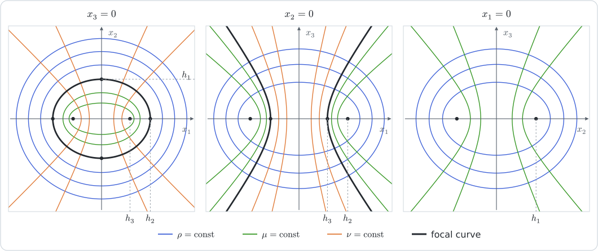

# [Ellipsoidal coordinates](@id th-ellipsoidal)

!!! tip "See also"
    **Theory**: [Spheroidal coordinates](@ref th-spheroidal) · [Curvilinear differential calculus](@ref th-curvilinear)

    **Manual**: [Coordinate systems (symbolic)](@ref man-coorsystems) · [Charts and coordinate conversions](@ref man-charts)

    **Tutorials**: [The spheroid in spheroidal coordinates](@ref tut-spheroidal-appendix) · [Ellipsoidal coordinates](@ref tut-ellipsoidal)

The ellipsoidal coordinates are the orthogonal system whose coordinate
surfaces are the quadrics confocal with a triaxial ellipsoid: the ellipsoid
itself is one of them, as the spheroid is in
[Spheroidal coordinates](@ref th-spheroidal). This page derives the chart, its
Lamé coefficients and its unit vectors from a single rational function, then
writes the differential operators and the inversion of the chart. The
coordinates ``(\rho,\mu,\nu)`` and the semi-focal distances ``h_1,h_2,h_3``
are those of [dassios2012](@citet).

## Confocal quadrics

Let ``a_1>a_2>a_3>0`` be the semi-axes of an ellipsoid along
``\underline{e}_1,\underline{e}_2,\underline{e}_3``. The quadrics

```math
\frac{x_1^2}{a_1^2-\lambda}+\frac{x_2^2}{a_2^2-\lambda}+\frac{x_3^2}{a_3^2-\lambda}=1
```

share the foci of its three principal sections, at the semi-focal distances

```math
h_1^2=a_2^2-a_3^2,
\qquad
h_2^2=a_1^2-a_3^2,
\qquad
h_3^2=a_1^2-a_2^2,
\qquad
h_1^2=h_2^2-h_3^2 .
```

With ``\kappa=a_1^2-\lambda``, the family only depends on ``h_2>h_3>0``:

```math
F(\kappa)=1-\frac{x_1^2}{\kappa}-\frac{x_2^2}{\kappa-h_3^2}-\frac{x_3^2}{\kappa-h_2^2}=0 .
```

At a point off the coordinate planes, ``F`` increases from ``-\infty`` to
``+\infty`` on each of the intervals ``(0,h_3^2)`` and ``(h_3^2,h_2^2)``, and
from ``-\infty`` to ``1`` on ``(h_2^2,\infty)``: it has exactly one root in
each. The three roots, in increasing order, are the squares of the
**ellipsoidal coordinates**,

```math
0\le\nu^2\le h_3^2\le\mu^2\le h_2^2\le\rho^2 .
```

Through the point pass the hyperboloid of two sheets ``\nu=\text{const}``, the
hyperboloid of one sheet ``\mu=\text{const}`` and the ellipsoid
``\rho=\text{const}``, of semi-axes

```math
\rho,\qquad\sqrt{\rho^2-h_3^2},\qquad\sqrt{\rho^2-h_2^2} .
```

The reference ellipsoid is ``\rho=a_1``. The three coordinates are lengths.

The three panels show the traces of the three families in the planes ``x_3=0``, ``x_2=0`` and ``x_1=0``, for ``h_2=1.2`` and ``h_3=0.7``; the focal curve that lies in a plane is drawn thicker.



## The chart

Once reduced to its common denominator, ``F`` is a ratio of two cubics of
leading coefficient one; its roots and its poles being known,

```math
F(\kappa)=\frac{(\kappa-\rho^2)\,(\kappa-\mu^2)\,(\kappa-\nu^2)}{\kappa\,(\kappa-h_3^2)\,(\kappa-h_2^2)} .
```

The residues of the two expressions at the poles ``\kappa=0``, ``h_3^2`` and
``h_2^2`` give the squares of the Cartesian coordinates:

```math
x_1^2=\frac{\rho^2\mu^2\nu^2}{h_2^2h_3^2},
\qquad
x_2^2=\frac{(\rho^2-h_3^2)\,(\mu^2-h_3^2)\,(h_3^2-\nu^2)}{h_1^2h_3^2},
\qquad
x_3^2=\frac{(\rho^2-h_2^2)\,(h_2^2-\mu^2)\,(h_2^2-\nu^2)}{h_1^2h_2^2} .
```

Eight points, one in each octant, have the same ``(\rho^2,\mu^2,\nu^2)``. The
chart of `TensND` takes the positive square roots and lets ``\nu`` change sign,

```math
x_1=\frac{\rho\,\mu\,\nu}{h_2h_3},
\qquad
x_2=\frac{\bar{\rho}_3\,\bar{\mu}_3\,\bar{\nu}_3}{h_1h_3},
\qquad
x_3=\frac{\bar{\rho}_2\,\bar{\mu}_2\,\bar{\nu}_2}{h_1h_2},
```

```math
\bar{\rho}_i=\sqrt{\rho^2-h_i^2},
\qquad
\bar{\mu}_2=\sqrt{h_2^2-\mu^2},\quad\bar{\mu}_3=\sqrt{\mu^2-h_3^2},
\qquad
\bar{\nu}_i=\sqrt{h_i^2-\nu^2},
```

with ``\rho\ge h_2``, ``h_3\le\mu\le h_2`` and ``-h_3\le\nu\le h_3``. It covers
the quarter space ``x_2\ge0``, ``x_3\ge0``, the sign of ``\nu`` being that of
``x_1``; the other three quarters are its mirror images in the planes
``x_2=0`` and ``x_3=0``.

## Lamé coefficients and unit vectors

Each coordinate enters one factor of each ``x_i``, so that, with
``(e_1,e_2,e_3)=(0,h_3^2,h_2^2)``,

```math
\frac{\partial x_i}{\partial\rho}=\frac{\rho\,x_i}{\rho^2-e_i},
\qquad
\frac{\partial x_i}{\partial\mu}=\frac{\mu\,x_i}{\mu^2-e_i},
\qquad
\frac{\partial x_i}{\partial\nu}=\frac{\nu\,x_i}{\nu^2-e_i} .
```

The scalar products of the natural vectors are then sums that ``F`` and its
derivative ``F'(\kappa)=\sum_ix_i^2/(\kappa-e_i)^2`` evaluate at its roots. For
two different coordinates, a partial-fraction decomposition gives

```math
\underline{a}_\rho\cdot\underline{a}_\mu
=\rho\,\mu\sum_i\frac{x_i^2}{(\rho^2-e_i)\,(\mu^2-e_i)}
=\rho\,\mu\,\frac{F(\rho^2)-F(\mu^2)}{\rho^2-\mu^2}=0 :
```

the system is orthogonal. For the same coordinate,

```math
\chi_\rho^2=\rho^2\,F'(\rho^2)
=\frac{(\rho^2-\mu^2)\,(\rho^2-\nu^2)}{(\rho^2-h_3^2)\,(\rho^2-h_2^2)},
```

the derivative of the factorized form of ``F`` at its root ``\rho^2`` keeping
one term only. Likewise

```math
\chi_\mu^2=\frac{(\rho^2-\mu^2)\,(\mu^2-\nu^2)}{(\mu^2-h_3^2)\,(h_2^2-\mu^2)},
\qquad
\chi_\nu^2=\frac{(\rho^2-\nu^2)\,(\mu^2-\nu^2)}{(h_3^2-\nu^2)\,(h_2^2-\nu^2)} .
```

The unit vectors are the natural vectors divided by their norms,

```math
\underline{e}^\rho=\frac{\rho}{\chi_\rho}\sum_i\frac{x_i}{\rho^2-e_i}\,\underline{e}_i,
\qquad
\underline{e}^\mu=\frac{\mu}{\chi_\mu}\sum_i\frac{x_i}{\mu^2-e_i}\,\underline{e}_i,
```

```math
\underline{e}^\nu=\frac{\nu}{\chi_\nu}\sum_i\frac{x_i}{\nu^2-e_i}\,\underline{e}_i ,
```

where ``\underline{e}^\rho`` is the outward normal of the ellipsoid. Taken in
the order of the coordinates, the triad is **left-handed**:
``(\underline{e}^\rho,\underline{e}^\nu,\underline{e}^\mu)`` is the
right-handed one. The gradient, the divergence and the Laplacian do not depend
on the orientation.

[`coorsys_ellipsoidal`](@ref) returns this system;
[`EllipsoidalChart`](@ref) is the same map between numbers.

```@raw html
<ClientOnly><FrameFigure kind="ellipsoidal" /></ClientOnly>
```

## Differential operators

The volume element is

```math
\mathrm{d}\Omega=\chi_\rho\,\chi_\mu\,\chi_\nu\,\mathrm{d}\rho\,\mathrm{d}\mu\,\mathrm{d}\nu
=\frac{(\rho^2-\mu^2)\,(\rho^2-\nu^2)\,(\mu^2-\nu^2)}
{\bar{\rho}_2\,\bar{\rho}_3\,\bar{\mu}_2\,\bar{\mu}_3\,\bar{\nu}_2\,\bar{\nu}_3}\,
\mathrm{d}\rho\,\mathrm{d}\mu\,\mathrm{d}\nu ,
```

and the operators of an orthogonal system
([Curvilinear differential calculus](@ref th-orthogonal-operators)) read, for a
scalar field ``f``,

```math
\underline{\nabla}f=\frac{1}{\chi_\rho}\,\frac{\partial f}{\partial\rho}\,\underline{e}^\rho
+\frac{1}{\chi_\mu}\,\frac{\partial f}{\partial\mu}\,\underline{e}^\mu
+\frac{1}{\chi_\nu}\,\frac{\partial f}{\partial\nu}\,\underline{e}^\nu ,
```

```math
\begin{aligned}
\Delta f={}&\frac{\bar{\rho}_2\,\bar{\rho}_3}{(\rho^2-\mu^2)\,(\rho^2-\nu^2)}\,
\frac{\partial}{\partial\rho}\Bigl(\bar{\rho}_2\,\bar{\rho}_3\,\frac{\partial f}{\partial\rho}\Bigr)
+\frac{\bar{\mu}_2\,\bar{\mu}_3}{(\rho^2-\mu^2)\,(\mu^2-\nu^2)}\,
\frac{\partial}{\partial\mu}\Bigl(\bar{\mu}_2\,\bar{\mu}_3\,\frac{\partial f}{\partial\mu}\Bigr)\\
&+\frac{\bar{\nu}_2\,\bar{\nu}_3}{(\rho^2-\nu^2)\,(\mu^2-\nu^2)}\,
\frac{\partial}{\partial\nu}\Bigl(\bar{\nu}_2\,\bar{\nu}_3\,\frac{\partial f}{\partial\nu}\Bigr) .
\end{aligned}
```

Each term follows from a ratio such as
``\chi_\mu\chi_\nu/\chi_\rho=(\mu^2-\nu^2)\,\bar{\rho}_2\bar{\rho}_3/(\bar{\mu}_2\bar{\mu}_3\bar{\nu}_2\bar{\nu}_3)``,
whose factor ``\mu^2-\nu^2`` does not depend on ``\rho``. Each of the three
operators ``\bar{\rho}_2\bar{\rho}_3\,\partial_\rho`` is a plain derivative
with respect to an elliptic integral of its coordinate, and the Laplace
equation separates into three copies of the Lamé equation
[dassios2012](@cite).

## The ellipsoid as a surface

On the ellipsoid ``\rho=\text{const}``, ``(\mu,\nu)`` is a chart and
``\underline{e}^\rho`` the unit normal. As for the spheroid,
``b_{\alpha\alpha}=-\chi_\alpha\,\partial_\rho\chi_\alpha/\chi_\rho``, and
``\partial_\rho\chi_\mu=\rho\,\chi_\mu/(\rho^2-\mu^2)`` gives the principal
curvatures

```math
\kappa_\mu=-\frac{\rho}{\chi_\rho\,(\rho^2-\mu^2)},
\qquad
\kappa_\nu=-\frac{\rho}{\chi_\rho\,(\rho^2-\nu^2)} :
```

the coordinate lines of the ellipsoid are its lines of curvature. Their
product is the Gaussian curvature

```math
K=\frac{\rho^2\,(\rho^2-h_3^2)\,(\rho^2-h_2^2)}{(\rho^2-\mu^2)^2\,(\rho^2-\nu^2)^2} ,
```

the square of the product of the semi-axes over
``(\rho^2-\mu^2)^2(\rho^2-\nu^2)^2``.

## Spheroidal and spherical limits

When two semi-focal distances merge, the ellipsoids become spheroids:

| Limit | Ellipsoids ``\rho=\text{const}`` | Spheroidal coordinates |
| :---- | :------------------------------- | :--------------------- |
| ``h_3\to0`` (``h_1=h_2``) | oblate, of axis ``\underline{e}_3`` | ``c=h_2``, ``\tau=\bar{\rho}_2/h_2`` |
| ``h_3\to h_2`` (``h_1\to0``) | prolate, of axis ``\underline{e}_1`` | ``c=h_2``, ``q=\rho/h_2`` |

The chart itself is singular in both limits, a factor of ``\underline{OM}``
taking the form ``0/0``: a spheroid is handled by its own system. Far from the
foci, ``\rho`` tends to the radius ``r`` and the ellipsoids to spheres.

## Inversion of the chart

The coordinates of a given point are the roots of ``F``, that is of the cubic

```math
\kappa^3+a\,\kappa^2+b\,\kappa+d=0,
\qquad
\begin{aligned}
a&=-\bigl(x_1^2+x_2^2+x_3^2+h_2^2+h_3^2\bigr),\\
b&=(h_2^2+h_3^2)\,x_1^2+h_2^2\,x_2^2+h_3^2\,x_3^2+h_2^2h_3^2,\\
d&=-h_2^2h_3^2\,x_1^2 .
\end{aligned}
```

Its three roots being real, they are given by the trigonometric form of
Viète: with ``P=b-a^2/3`` and ``Q=2a^3/27-ab/3+d``,

```math
\kappa_k=-\frac{a}{3}+2\sqrt{-\frac{P}{3}}\,
\cos\Bigl(\frac{\theta-2k\pi}{3}\Bigr),
\qquad
\theta=\arccos\Bigl(\frac{3Q}{2P}\sqrt{-\frac{3}{P}}\Bigr),
\qquad k=0,1,2,
```

where ``k=0`` gives the largest root ``\rho^2`` and ``k=1`` the middle one
``\mu^2``. The smallest is not computed as ``\kappa_2``, a difference of close
numbers near the plane ``x_1=0``, but from the product of the roots,
``\rho^2\mu^2\nu^2=-d``:

```math
\nu=\frac{h_2\,h_3\,x_1}{\rho\,\mu} ,
```

which also carries the sign of ``x_1``. [`cartesian_to_coords`](@ref) returns
``(\rho,\mu,\nu)`` for the mirror image of the point in the quarter space of
the chart. Near the planes ``x_2=0`` and ``x_3=0`` a difference such as
``\mu^2-h_3^2`` is small: the coordinates are accurate, but the point they
represent is recovered with the accuracy of that difference. The inversions of
the other charts and the changes between charts are the subject of
[Changes of coordinates](@ref th-coordinate-changes).
