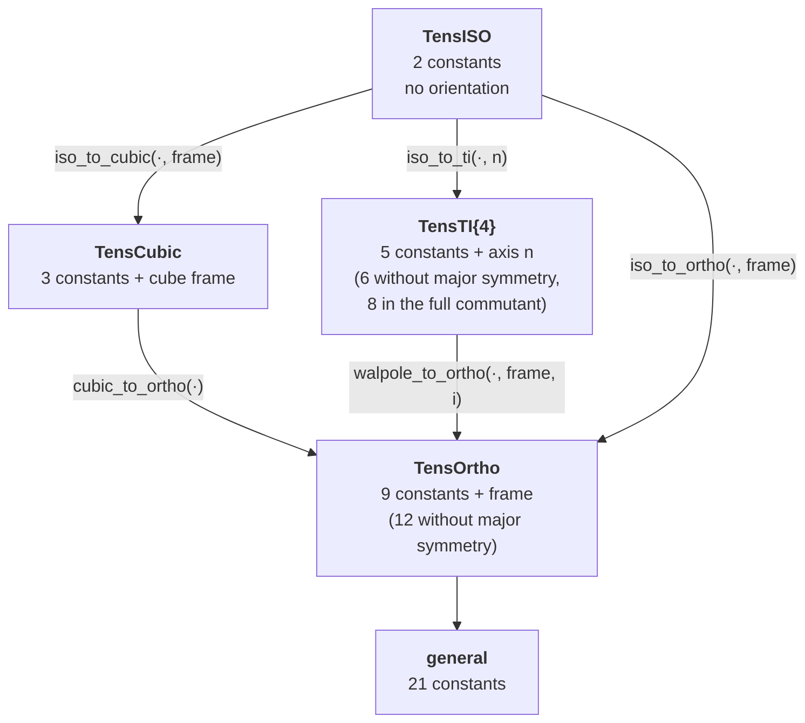

# [Orthotropy](@id th-orthotropy)

Orthotropy is invariance under the reflections through three mutually orthogonal
planes. It is the least constrained class `TensND` gives a dedicated storage
type ([`TensOrtho`](@ref), `src/tens_anisotropic.jl`): nine constants plus a material
frame, against 21 for a general minor- and major-symmetric tensor, or twelve
constants for an orthotropic tensor without major symmetry.

## The coefficients

Let ``(\underline{e}_1,\underline{e}_2,\underline{e}_3)`` be the orthonormal
**material frame** and ``\boldsymbol{P}_m=\underline{e}_m\otimes\underline{e}_m``
the associated projectors. Then

```math
\begin{aligned}
\mathbb{C}=\;&C_{11}\,\boldsymbol{P}_1{\otimes}\boldsymbol{P}_1
            +C_{22}\,\boldsymbol{P}_2{\otimes}\boldsymbol{P}_2
            +C_{33}\,\boldsymbol{P}_3{\otimes}\boldsymbol{P}_3\\
           &+C_{12}\bigl(\boldsymbol{P}_1{\otimes}\boldsymbol{P}_2
                        +\boldsymbol{P}_2{\otimes}\boldsymbol{P}_1\bigr)
            +C_{13}\bigl(\boldsymbol{P}_1{\otimes}\boldsymbol{P}_3
                        +\boldsymbol{P}_3{\otimes}\boldsymbol{P}_1\bigr)\\
           &+C_{23}\bigl(\boldsymbol{P}_2{\otimes}\boldsymbol{P}_3
                        +\boldsymbol{P}_3{\otimes}\boldsymbol{P}_2\bigr)\\
           &+2C_{44}\,\boldsymbol{P}_2\stackrel{s}{\boxtimes}\boldsymbol{P}_3
            +2C_{55}\,\boldsymbol{P}_1\stackrel{s}{\boxtimes}\boldsymbol{P}_3
            +2C_{66}\,\boldsymbol{P}_1\stackrel{s}{\boxtimes}\boldsymbol{P}_2 .
\end{aligned}
```

## Block-diagonal in the material frame

The whole point of the class is that in its own frame the Kelvin–Mandel matrix
splits:

```math
\begin{aligned}
\mathrm{Mat}_{\text{mat}}(\mathbb{C})
&=\begin{pmatrix}
C_{11}&C_{12}&C_{13}&&&\\
C_{12}&C_{22}&C_{23}&&&\\
C_{13}&C_{23}&C_{33}&&&\\
&&&2C_{44}&&\\
&&&&2C_{55}&\\
&&&&&2C_{66}
\end{pmatrix}\\[6pt]
&=\underbrace{\begin{bmatrix}3\times3\\ \text{symmetric}\end{bmatrix}}_{\text{6 constants}}
\;\oplus\;
\underbrace{\mathrm{diag}(2C_{44},2C_{55},2C_{66})}_{\text{3 constants}}
\end{aligned}
```

Extension and shear decouple entirely. This is [`mandel_material`](@ref); the matrix
in the canonical frame is [`mandel`](@ref), and the two are related by the orthogonal
congruence of [Kelvin–Mandel representation](@ref th-kelvin-mandel),

```math
\mathrm{Mat}(\mathbb{C})=Q\;\mathrm{Mat}_{\text{mat}}(\mathbb{C})\;{}^{t}Q ,
```

with ``Q`` built from the frame vectors directly (`_km_congruence`), without
going through Euler angles. Because the two blocks never mix, the closed-form
inverse is one ``3\times3`` inverse plus three reciprocals, and the closed-form
double contraction one ``3\times3`` product plus three scalar products — instead
of two dense 81-component expansions.

## Major symmetry and storage

```math
\mathbb{C}={}^{t}\mathbb{C}
\quad\Longleftrightarrow\quad
C_{mn}=C_{nm}
\quad\Longleftrightarrow\quad
C={}^{t}C ,
```

with ``C`` the normal ``3\times3`` block, ``C_{mn}`` its entry in row ``m``
(stress) and column ``n`` (strain), the coefficient of
``\boldsymbol{P}_m\otimes\boldsymbol{P}_n``. A major-symmetric orthotropic tensor
therefore needs **nine** constants, a general one **twelve**:

| Storage | Coefficients | Case |
| :------ | :----------- | :--- |
| `TensOrtho{4,T,9}` | ``(C_{11},C_{22},C_{33},C_{12},C_{13},C_{23},C_{44},C_{55},C_{66})`` | major-symmetric, ``C_{nm}=C_{mn}`` |
| `TensOrtho{4,T,12}` | the nine, then ``(C_{21},C_{31},C_{32})`` | general |

The widening is not cosmetic: the product of two *major-symmetric*
orthotropic tensors is generally **not** major-symmetric, because
``C\,D\neq{}^{t}(C\,D)`` unless the two blocks commute, so
`TensOrtho{4,T,9} ⊡ TensOrtho{4,T,9}` returns an `N=12` container, as
`TensTI{4,T,5} ⊡ TensTI{4,T,5}` returns `N=6` ([The Walpole basis](@ref th-walpole)).
The cause is the same in both classes: the **major-symmetric tensors of a class
do not form a subalgebra**, only the class itself does. The twelve-constant
tensors of a frame do: products and inverses act on the blocks,

```math
(\mathbb{C}:\mathbb{D})_{\text{normal}}=C\,D,\qquad
(\mathbb{C}:\mathbb{D})_{mm}=2\,C_{mm}D_{mm},\qquad
(\mathbb{C}^{-1})_{\text{normal}}=C^{-1},\qquad
(\mathbb{C}^{-1})_{mm}=\frac{1}{4C_{mm}}
\quad(m=4,5,6),
```

and the transpose transposes ``C``. Writing ``a_{mn}=\tfrac12(C_{mn}-C_{nm})``,
a twelve-constant tensor is its symmetric part plus

```math
\sum_{m<n} a_{mn}\bigl(\boldsymbol{P}_m\otimes\boldsymbol{P}_n
                      -\boldsymbol{P}_n\otimes\boldsymbol{P}_m\bigr),
```

a skew part orthogonal to every major-symmetric tensor: the orthogonal
projection onto the nine-constant class is the major-symmetric part
(`Tensors.majorsymmetric`).

[Cubic symmetry](@ref th-cubic) is the exception that shows what is really at
stake. There each irreducible representation of the group appears with
multiplicity **one**, so the commutant is spanned by three mutually orthogonal
projectors, any two cubic tensors about the same cube commute, and the product
stays in the class *and* stays major-symmetric. Orthotropy fails on both counts
for the same reason: its ``3\times3`` block is a two-dimensional family of
representations, not three one-dimensional ones.

When the two operands are expressed in *different* material frames the product is
generally fully anisotropic, and the implementation falls back to the generic
route bit for bit. A transversely isotropic operand whose axis is one of the
frame axes is orthotropic on that frame, and its product with an orthotropic
tensor stays in the twelve-constant form.

## No chiral shape

Transverse isotropy has two families of shapes: those invariant under the full
group ``D_{\infty h}`` (rotations about ``\underline{n}`` and the mirrors), and
the larger ones invariant under the rotations ``SO(2)`` only, which hold the
terms odd in ``\underline{n}`` ([The extended Walpole algebra](@ref th-walpole-extended)).
Orthotropy has no such pair. Its group ``D_{2h}`` is the rotation group ``D_2``
(the half-turns about the three frame axes) times the inversion
``-\boldsymbol{1}``, and the inversion acts on a tensor of order ``r`` as
``(-1)^r``, trivially at even order: ``D_2`` and ``D_{2h}`` have the same
invariant tensors of order 2 and 4, and the shapes above are the whole family.
The test suite checks it by averaging tensors over both groups.

## Where the classes sit



Each arrow is an **exact** re-expression, not an approximation: an isotropic
tensor really is transversely isotropic about every axis, and a transversely
isotropic one really is orthotropic in any frame containing its axis. The
converse direction — pushing an arbitrary tensor *down* the chain — is
approximation, and is the subject of
[Projection onto a symmetry class](@ref th-projection).

The promotions are implemented in `src/structured_tens_promotion.jl` and are
what allow mixed-class arithmetic (`TensISO ⊡ TensOrtho`, `TensTI{2} ⊡ TensTI{4}`)
to stay in closed form.

## Order-2 orthotropy

The same construction one order down: an orthotropic order-2 tensor is

```math
\boldsymbol{a}=a_1\,\boldsymbol{P}_1+a_2\,\boldsymbol{P}_2+a_3\,\boldsymbol{P}_3 ,
```

three coefficients and a frame, stored as `TensOrtho{2,T,3}`. A second-order
tensor invariant under the three mirror planes is necessarily diagonal in the
frame, hence symmetric: there is no general order-2 shape, unlike the skew
``c\,\boldsymbol{w}`` of transverse isotropy under ``SO(2)``. Products and
inverses are termwise, since the ``\boldsymbol{P}_m`` are complementary
orthogonal projectors, and the tensor is isotropic exactly when
``a_1=a_2=a_3``. With an order-4 tensor on the same frame the double
contraction is the normal block acting on the coefficients,

```math
\mathbb{C}:\boldsymbol{a}=\sum_m\Bigl(\sum_n C_{mn}\,a_n\Bigr)\boldsymbol{P}_m ,
```

the shear terms vanishing on a diagonal tensor, and the tensor product
``\boldsymbol{a}\otimes\boldsymbol{b}`` has the normal block
``a\,{}^{t}b`` and no shear: twelve constants, nine for
``\boldsymbol{a}\otimes\boldsymbol{a}``. Every symmetric order-2 tensor is
orthotropic in its own eigenframe, which is why order-2 orthotropy is never an
interesting *hypothesis*, only a useful *representation*; the projection at fixed
frame keeps the diagonal and returns a `TensOrtho{2}`, as
[Projection onto a symmetry class](@ref th-projection) makes explicit.
