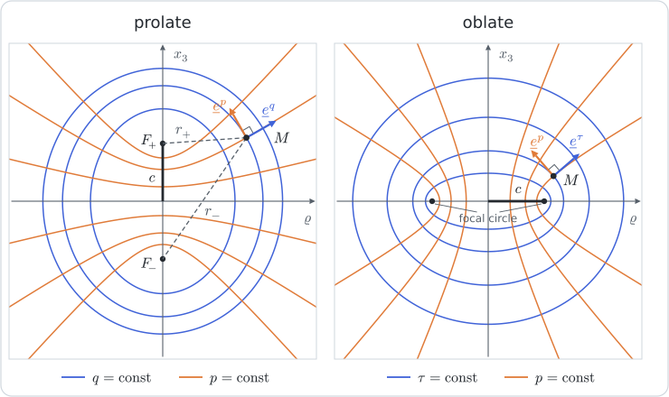

# [Spheroidal coordinates](@id th-spheroidal)

!!! tip "See also"
    **Theory**: [Ellipsoidal coordinates](@ref th-ellipsoidal) · [Curvilinear differential calculus](@ref th-curvilinear) · [Spheroidal harmonics and their re-expansion](@ref th-spheroidal-harmonics)

    **Manual**: [Coordinate systems (symbolic)](@ref man-coorsystems) · [Charts and coordinate conversions](@ref man-charts) · [Spheroidal harmonics](@ref man-spheroidal-harmonics)

    **Tutorials**: [The spheroid in spheroidal coordinates](@ref tut-spheroidal-appendix) · [Ellipsoidal coordinates](@ref tut-ellipsoidal) · [Changing the focal distance of spheroidal harmonics](@ref tut-spheroidal-reexpansion)

A spheroid is an ellipsoid of revolution. The spheroidal coordinates are the
orthogonal system in which a family of confocal spheroids is a family of
coordinate surfaces: the natural system for a spheroidal inclusion, a
penny-shaped crack or a needle. This page builds the prolate and the oblate
systems with the steps of
[Curvilinear differential calculus](@ref th-curvilinear), then writes their
differential operators and the geometry of a spheroid seen as a surface. The
notation is that of the appendix of [barthelemy2020](@citet).

## Confocal conics of a meridian plane

In a half-plane bounded by the axis ``\underline{e}_3``, a point is located by
its distance ``\varrho`` to the axis and its height ``z``. Let ``F_\pm`` be the
two points ``z=\pm c`` of the axis and ``r_\pm`` the distances from the point
to them. The pair

```math
q=\frac{r_-+r_+}{2c}\ge1,
\qquad
p=\frac{r_--r_+}{2c}\in[-1,1]
```

is constant, for ``q``, on an ellipse of foci ``F_\pm`` and, for ``p``, on a
branch of hyperbola of the same foci. Since
``r_\pm^2=\varrho^2+(z\mp c)^2``, the product and the sum of the squares of
``r_\pm=c\,(q\mp p)`` give

```math
z=c\,p\,q,
\qquad
\varrho=c\,\sqrt{1-p^2}\,\sqrt{q^2-1} .
```

The ellipses and the hyperbolas cross at right angles, which the Lamé
coefficients below confirm.

The two panels show a meridian plane of the prolate and of the oblate system: the confocal ellipses (``q`` or ``\tau`` constant), the confocal hyperbolas (``p`` constant), the foci and, at a point ``M``, the two orthogonal unit vectors of the chart.



## The prolate system

Revolving the meridian plane about the axis that carries the foci gives the
**prolate** system ``(\varphi,p,q)``, with ``c>0`` the semi-focal distance:

```math
\underline{OM}=c\,\bigl(\bar{p}\,\bar{q}\,\underline{u}_\varphi+p\,q\,\underline{e}_3\bigr),
\qquad
\underline{u}_\varphi=\cos\varphi\,\underline{e}_1+\sin\varphi\,\underline{e}_2,
\qquad
\bar{p}=\sqrt{1-p^2},\quad\bar{q}=\sqrt{q^2-1} .
```

The surface ``q=\text{const}`` is the prolate spheroid of semi-axes
``c\,q`` along ``\underline{e}_3`` and ``c\,\bar{q}`` across,

```math
\frac{x_1^2+x_2^2}{c^2\,(q^2-1)}+\frac{x_3^2}{c^2q^2}=1 ,
```

of aspect ratio ``\omega=q/\bar{q}>1``; ``q=1`` is the segment that joins the
foci. The surface ``p=\text{const}`` is the sheet, on the side ``x_3/p>0``, of
the hyperboloid of two sheets

```math
\frac{x_3^2}{c^2p^2}-\frac{x_1^2+x_2^2}{c^2\,(1-p^2)}=1 ,
```

and ``\varphi=\text{const}`` is a half-plane bounded by the axis.

The natural vectors are the derivatives of the position vector,

```math
\underline{a}_\varphi=c\,\bar{p}\,\bar{q}\,\underline{e}^\varphi,
\qquad
\underline{a}_p=c\,\Bigl(-\frac{p\,\bar{q}}{\bar{p}}\,\underline{u}_\varphi+q\,\underline{e}_3\Bigr),
\qquad
\underline{a}_q=c\,\Bigl(\frac{q\,\bar{p}}{\bar{q}}\,\underline{u}_\varphi+p\,\underline{e}_3\Bigr),
```

with ``\underline{e}^\varphi=-\sin\varphi\,\underline{e}_1+\cos\varphi\,\underline{e}_2``.
They are mutually orthogonal:
``\underline{a}_p\cdot\underline{a}_q=c^2\,(-p\,q+p\,q)=0``. Their norms are
the Lamé coefficients

```math
\chi_\varphi=c\,\bar{p}\,\bar{q},
\qquad
\chi_p=c\,\frac{\sqrt{q^2-p^2}}{\bar{p}},
\qquad
\chi_q=c\,\frac{\sqrt{q^2-p^2}}{\bar{q}},
```

and the normalized basis, ordered as the coordinates, is the right-handed triad

```math
\underline{e}^\varphi,
\qquad
\underline{e}^p=\frac{-p\,\bar{q}\,\underline{u}_\varphi+q\,\bar{p}\,\underline{e}_3}{\sqrt{q^2-p^2}},
\qquad
\underline{e}^q=\frac{q\,\bar{p}\,\underline{u}_\varphi+p\,\bar{q}\,\underline{e}_3}{\sqrt{q^2-p^2}} .
```

Far from the foci, as ``q\to\infty``, ``c\,q`` tends to the radius ``r`` and
``p`` to ``\cos\theta``: the spheroids and the hyperboloids become the spheres
and the cones of the spherical system.

[`coorsys_spheroidal`](@ref) returns this system;
[`ProlateSpheroidalChart`](@ref) is the same map between numbers.

## The oblate system

Revolving the same conics about the axis that does *not* carry the foci gives
the **oblate** system ``(\varphi,p,\tau)``, with ``-1\le p\le1`` and
``\tau\ge0``:

```math
\underline{OM}=c\,\bigl(\bar{p}\,\bar{\tau}\,\underline{u}_\varphi+p\,\tau\,\underline{e}_3\bigr),
\qquad
\bar{\tau}=\sqrt{\tau^2+1} .
```

The foci now form the circle of radius ``c`` in the plane ``x_3=0``. The
surface ``\tau=\text{const}`` is the oblate spheroid of semi-axes ``c\,\tau``
along ``\underline{e}_3`` and ``c\,\bar{\tau}`` across, of aspect ratio
``\omega=\tau/\bar{\tau}<1``; ``\tau=0`` is the disk bounded by the focal
circle. The surface ``p=\text{const}`` is the half, on the side ``x_3/p>0``, of
the hyperboloid of one sheet

```math
\frac{x_1^2+x_2^2}{c^2\,(1-p^2)}-\frac{x_3^2}{c^2p^2}=1 .
```

The oblate chart is the prolate one in which ``c`` is replaced by ``-\imath\,c``
and ``q`` by ``\imath\,\tau``, with ``\sqrt{-1}=\imath``: indeed
``c\,q\to c\,\tau`` and ``c\,\sqrt{q^2-1}\to c\,\sqrt{\tau^2+1}``. Every formula
of the prolate system therefore carries over,

```math
\chi_\varphi=c\,\bar{p}\,\bar{\tau},
\qquad
\chi_p=c\,\frac{\sqrt{\tau^2+p^2}}{\bar{p}},
\qquad
\chi_\tau=c\,\frac{\sqrt{\tau^2+p^2}}{\bar{\tau}},
```

```math
\underline{e}^p=\frac{-p\,\bar{\tau}\,\underline{u}_\varphi+\tau\,\bar{p}\,\underline{e}_3}{\sqrt{\tau^2+p^2}},
\qquad
\underline{e}^\tau=\frac{\tau\,\bar{p}\,\underline{u}_\varphi+p\,\bar{\tau}\,\underline{e}_3}{\sqrt{\tau^2+p^2}} .
```

[`coorsys_spheroidal_oblate`](@ref) returns this system;
[`OblateSpheroidalChart`](@ref) is the same map between numbers.

The figure draws either system at a point set by the sliders; its buttons
switch between the two and a fourth slider sets ``c``, the unit vectors of the
canonical basis giving the scale.

```@raw html
<ClientOnly><FrameFigure kind="spheroidal" /></ClientOnly>
```

## Volume and surface elements

The volume element is the product of the three Lamé coefficients, and the
surface element of a spheroid ``q=\text{const}`` the product of the two
tangent ones:

```math
\mathrm{d}\Omega=\chi_\varphi\,\chi_p\,\chi_q\,\mathrm{d}\varphi\,\mathrm{d}p\,\mathrm{d}q
=c^3\,(q^2-p^2)\,\mathrm{d}\varphi\,\mathrm{d}p\,\mathrm{d}q,
\qquad
\mathrm{d}S_q=\chi_\varphi\,\chi_p\,\mathrm{d}\varphi\,\mathrm{d}p
=c^2\,\bar{q}\,\sqrt{q^2-p^2}\,\mathrm{d}\varphi\,\mathrm{d}p .
```

Integrated over ``\varphi\in[0,2\pi]``, ``p\in[-1,1]`` and, for the volume,
over the radial coordinate from the focal set to the spheroid, they give

```math
V=\frac{4}{3}\,\pi\,c^3\,q\,(q^2-1),
\qquad
S=2\,\pi\,c^2\,\bar{q}\,\Bigl(\bar{q}+q^2\arcsin\frac{1}{q}\Bigr)
\qquad\text{(prolate)},
```

```math
V=\frac{4}{3}\,\pi\,c^3\,\tau\,(\tau^2+1),
\qquad
S=2\,\pi\,c^2\,\bar{\tau}\,\Bigl(\bar{\tau}+\tau^2\,\mathrm{arcsinh}\frac{1}{\tau}\Bigr)
\qquad\text{(oblate)}.
```

## Differential operators

In an orthogonal system the operators of
[Curvilinear differential calculus](@ref th-orthogonal-operators) only involve
the Lamé coefficients. For a scalar field ``f`` of the prolate system,

```math
\underline{\nabla}f=\frac{1}{c\,\bar{p}\,\bar{q}}\,\frac{\partial f}{\partial\varphi}\,\underline{e}^\varphi
+\frac{\bar{p}}{c\,\sqrt{q^2-p^2}}\,\frac{\partial f}{\partial p}\,\underline{e}^p
+\frac{\bar{q}}{c\,\sqrt{q^2-p^2}}\,\frac{\partial f}{\partial q}\,\underline{e}^q ,
```

and, since ``\chi_\varphi\chi_q/\chi_p=c\,(1-p^2)``,
``\chi_\varphi\chi_p/\chi_q=c\,(q^2-1)`` and
``\chi_p\chi_q/\chi_\varphi=c\,(q^2-p^2)/(\bar{p}^2\bar{q}^2)``,

```math
\Delta f=\frac{1}{c^2\,(q^2-p^2)}\left[
\frac{\partial}{\partial p}\Bigl((1-p^2)\,\frac{\partial f}{\partial p}\Bigr)
+\frac{\partial}{\partial q}\Bigl((q^2-1)\,\frac{\partial f}{\partial q}\Bigr)
\right]
+\frac{1}{c^2\,(1-p^2)\,(q^2-1)}\,\frac{\partial^2f}{\partial\varphi^2} .
```

The divergence of a vector field
``\underline{v}=v_\varphi\,\underline{e}^\varphi+v_p\,\underline{e}^p+v_q\,\underline{e}^q``
is

```math
\mathrm{div}\,\underline{v}=\frac{1}{c\,\bar{p}\,\bar{q}}\,\frac{\partial v_\varphi}{\partial\varphi}
+\frac{1}{c\,(q^2-p^2)}\left[
\frac{\partial}{\partial p}\Bigl(\bar{p}\,\sqrt{q^2-p^2}\;v_p\Bigr)
+\frac{\partial}{\partial q}\Bigl(\bar{q}\,\sqrt{q^2-p^2}\;v_q\Bigr)\right] .
```

Because ``(q^2-p^2)/(\bar{p}^2\bar{q}^2)=1/(1-p^2)+1/(q^2-1)``, the equation
``\Delta f=0`` separates: the products

```math
P_n^m(p)\,P_n^m(q)\,e^{\imath m\varphi},
\qquad
P_n^m(p)\,Q_n^m(q)\,e^{\imath m\varphi}
```

of associated Legendre functions are harmonic, the first regular on the focal
segment, the second vanishing at infinity. They are the subject of
[Spheroidal harmonics and their re-expansion](@ref th-spheroidal-harmonics). The oblate formulas
follow by the substitution above: ``q^2-1\to\tau^2+1`` and
``q^2-p^2\to\tau^2+p^2``.

## The spheroid as a surface

On the spheroid ``q=\text{const}``, ``(\varphi,p)`` is a chart of the surface
and ``\underline{e}^q`` its unit normal, in the sense of
[Submanifolds](@ref th-submanifolds). Its first
fundamental form is diagonal,

```math
a_{\varphi\varphi}=\chi_\varphi^2=c^2\,\bar{p}^2\,\bar{q}^2,
\qquad
a_{pp}=\chi_p^2=c^2\,\frac{q^2-p^2}{1-p^2} .
```

The second fundamental form
``b_{\alpha\beta}=\underline{e}^q\cdot\partial_\alpha\underline{a}_\beta`` is
diagonal too. Differentiating
``\underline{a}_\alpha\cdot\underline{a}_q=0`` along ``\alpha`` and using
``\partial_\alpha\underline{a}_q=\partial_q\underline{a}_\alpha`` gives
``b_{\alpha\alpha}=-\chi_\alpha\,\partial_q\chi_\alpha/\chi_q``, hence the
principal curvatures ``\kappa_\alpha=b_{\alpha\alpha}/\chi_\alpha^2``:

```math
\kappa_\varphi=-\frac{q}{c\,\bar{q}\,\sqrt{q^2-p^2}},
\qquad
\kappa_p=-\frac{q\,\bar{q}}{c\,(q^2-p^2)^{3/2}} .
```

They are negative because the normal points outward. At the equator ``p=0``
they are ``-1/(c\,\bar{q})`` and ``-c\,\bar{q}/(c\,q)^2``, the inverse of the
equatorial radius and the curvature of the meridian ellipse at the end of its
minor axis; as ``q\to\infty`` both tend to ``-1/(c\,q)``, the curvature of the
sphere.

The surface operators differentiate along ``\varphi`` and ``p`` only. For a
scalar field ``f`` and a tangent field
``\underline{v}=v_\varphi\,\underline{e}^\varphi+v_p\,\underline{e}^p``,

```math
\underline{\nabla}_{\!S}f=\frac{1}{\chi_\varphi}\,\frac{\partial f}{\partial\varphi}\,\underline{e}^\varphi
+\frac{1}{\chi_p}\,\frac{\partial f}{\partial p}\,\underline{e}^p,
\qquad
\mathrm{div}_S\,\underline{v}=\frac{1}{\chi_\varphi\,\chi_p}\left[
\frac{\partial}{\partial\varphi}\bigl(\chi_p\,v_\varphi\bigr)
+\frac{\partial}{\partial p}\bigl(\chi_\varphi\,v_p\bigr)\right],
```

and their composition is the surface Laplacian

```math
\Delta_Sf=\frac{1}{c^2}\left[
\frac{1}{(1-p^2)\,(q^2-1)}\,\frac{\partial^2f}{\partial\varphi^2}
+\frac{1}{\sqrt{q^2-p^2}}\,\frac{\partial}{\partial p}
\Bigl(\frac{1-p^2}{\sqrt{q^2-p^2}}\,\frac{\partial f}{\partial p}\Bigr)\right] .
```

The surface divergence of the normal is minus the sum of the principal
curvatures,

```math
\mathrm{div}_S\,\underline{e}^q=-(\kappa_\varphi+\kappa_p)
=\frac{q\,(2q^2-p^2-1)}{c\,\bar{q}\,(q^2-p^2)^{3/2}} ,
```

which tends to ``2/r`` on a sphere.
[The spheroid in spheroidal coordinates](@ref tut-spheroidal-appendix) obtains
every result of this page with `TensND`.
