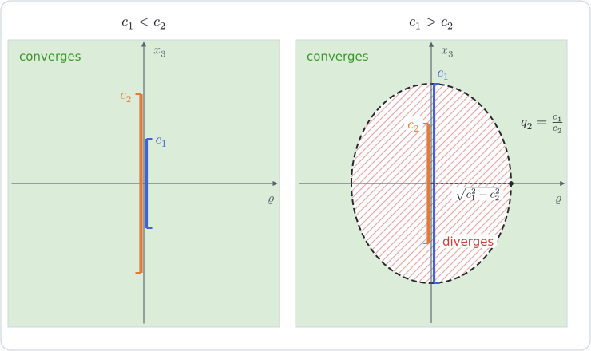

# [Spheroidal harmonics and their re-expansion](@id th-spheroidal-harmonics)

!!! tip "See also"
    **Theory**: [Spheroidal coordinates](@ref th-spheroidal)

    **Manual**: [Spheroidal harmonics](@ref man-spheroidal-harmonics) · [Charts and coordinate conversions](@ref man-charts)

    **Tutorials**: [Changing the focal distance of spheroidal harmonics](@ref tut-spheroidal-reexpansion) · [The spheroid in spheroidal coordinates](@ref tut-spheroidal-appendix)

The harmonic functions that separate in a spheroidal chart are products of
associated Legendre functions of the two meridian coordinates. This page
defines them, states how they are evaluated, and re-expresses a harmonic of one
chart in the harmonics of a coaxial chart of another semi-focal distance, which
is what a problem with two non-confocal spheroidal surfaces needs. The formulas
are those of the appendix of [riccardi1999](@citet), obtained here by another
route, extended to the mixed prolate/oblate pairs and to the spherical limit,
and completed by the domain of convergence of the exterior series.

The route uses no integral representation. Each spheroidal harmonic is first
expanded in spherical solid harmonics from its values near the axis. A
re-expansion is then an identity between the coefficients of these expansions,
which is the coefficient identity of Gegenbauer's expansion of a Bessel
function in Bessel functions of shifted order; the Bessel functions serve only
as generating series.

## Legendre functions

The meridian functions are the associated Legendre functions, with the
conventions of [barthelemy2020](@cite). With ``P_n`` the Legendre polynomial,
``F^{(m)}`` the ``m``-th derivative of ``F`` and ``Q_0(x)=\operatorname{arccoth}x``,

```math
P_n^m(p)=\bigl(-\sqrt{1-p^2}\bigr)^m P_n^{(m)}(p)\ \ (\lvert p\rvert\le1),
\qquad
P_n^m(q)=\bigl(\sqrt{q^2-1}\bigr)^m P_n^{(m)}(q),
\qquad
Q_n^m(q)=\bigl(\sqrt{q^2-1}\bigr)^m Q_n^{(m)}(q)\ \ (q>1).
```

Each family ``F_n^m`` satisfies, with ``x`` its argument,

```math
(n-m+1)\,F_{n+1}^m=(2n+1)\,x\,F_n^m-(n+m)\,F_{n-1}^m .
```

The functions ``Q_n`` are given by Neumann's classical integral

```math
Q_n(w)=\frac12\int_{-1}^{1}\frac{P_n(t)}{w-t}\,\mathrm{d}t,
\qquad w\in\mathbb{C}\setminus[-1,1],
```

which gives ``Q_0=\operatorname{arccoth}`` for ``w>1`` and satisfies the
recurrence for ``m=0``: multiply
``(n+1)P_{n+1}(t)-(2n+1)\,t\,P_n(t)+n\,P_{n-1}(t)=0`` by ``1/(w-t)``, write
``t=w-(w-t)`` and use ``\int_{-1}^1P_n=0`` for ``n\ge1``. It is the analytic
continuation of ``Q_n`` off the cut, used below at ``w=\imath\tau``.

The oblate chart takes ``q=\imath\tau``, with the branch
``\sqrt{(\imath\tau)^2-1}=\imath\sqrt{\tau^2+1}``. The **oblate radial
functions** are

```math
\mathcal{P}_n^m(\tau)=\imath^{-n}P_n^m(\imath\tau)
=\imath^{m-n}(1+\tau^2)^{m/2}P_n^{(m)}(\imath\tau),
\qquad
\mathcal{Q}_n^m(\tau)=\imath^{\,n+1}Q_n^m(\imath\tau)
=\imath^{\,n+1+m}(1+\tau^2)^{m/2}Q_n^{(m)}(\imath\tau).
```

Both are real for ``\tau>0``: ``P_n^{(m)}`` has the parity of ``n-m``, and
``Q_n^{(m)}(w)`` is a series in ``w^{-n-1-2k-m}`` (see the expansion of
``Q_n`` below). Examples are ``\mathcal{P}_0^0=1``,
``\mathcal{P}_1^0=\tau``, ``\mathcal{Q}_0^0(\tau)=\operatorname{arccot}\tau`` and
``\mathcal{Q}_1^0(\tau)=1-\tau\operatorname{arccot}\tau``. Substituting
``x=\imath\tau`` in the recurrence gives

```math
(n-m+1)\,\mathcal{P}_{n+1}^m=(2n+1)\,\tau\,\mathcal{P}_n^m+(n+m)\,\mathcal{P}_{n-1}^m,
\qquad
(n-m+1)\,\mathcal{Q}_{n+1}^m=-(2n+1)\,\tau\,\mathcal{Q}_n^m+(n+m)\,\mathcal{Q}_{n-1}^m,
```

with ``\mathcal{P}_m^m=(2m-1)!!\,(1+\tau^2)^{m/2}`` and
``\mathcal{P}_{m+1}^m=(2m+1)\,\tau\,\mathcal{P}_m^m``. The generic symbols
``\mathsf{P}_n^m`` and ``\mathsf{Q}_n^m`` stand for ``P_n^m`` and ``Q_n^m`` in
a prolate chart and for ``\mathcal{P}_n^m`` and ``\mathcal{Q}_n^m`` in an
oblate one. [`legendre_P`](@ref) evaluates ``P_n^m(p)`` on the cut, and
[`radial_P`](@ref) and [`radial_Q`](@ref) the radial functions.

## Interior and exterior harmonics

A harmonic of order ``m\ge0`` carries the factor ``e^{\imath m\varphi}``, omitted
below; the harmonics in ``e^{-\imath m\varphi}`` are the complex conjugates and
take the same real coefficients. Let ``c>0`` be the semi-focal distance of a
chart, ``\zeta`` its radial coordinate (``q`` or ``\tau``), ``s=1`` for a
prolate chart and ``s=-1`` for an oblate one, and

```math
\gamma=s\,c^2 .
```

The separation of ``\Delta f=0`` in [Spheroidal coordinates](@ref th-spheroidal)
shows that, for ``n\ge m``, the **interior** and **exterior harmonics**

```math
F_n=P_n^m(p)\,\mathsf{P}_n^m(\zeta),
\qquad
G_n=P_n^m(p)\,\mathsf{Q}_n^m(\zeta)
```

are harmonic, the first regular on the focal set and the second vanishing at
infinity; the oblate case follows from the prolate one by ``q\to\imath\tau``.
[`interior_harmonics`](@ref) and [`exterior_harmonics`](@ref) return them. The
**normalized harmonics**

```math
\tilde U_n(\gamma)=c^{\,n}F_n,
\qquad
\tilde V_n(\gamma)=c^{-n-1}G_n
```

are written with ``\gamma`` alone, since the expansions below depend on the
chart only through it. The solid harmonics of the spherical chart
``(r,\theta,\varphi)`` are

```math
R_l=r^l P_l^m(\cos\theta),
\qquad
S_l=r^{-l-1}P_l^m(\cos\theta),
```

and the order ``m`` enters every result through the ratios of

```math
g_n=\frac{(n+m)!}{(n-m)!},
\qquad
(a)_k=a(a+1)\cdots(a+k-1).
```

## Evaluation

The functions ``\mathsf{P}_n^m`` and ``P_n^m`` are the dominant solutions of
their recurrence: the upward recurrence from ``\mathsf{P}_m^m`` and
``\mathsf{P}_{m+1}^m`` is stable and is the one implemented in [`legendre_P`](@ref)
and [`radial_P`](@ref). The functions ``\mathsf{Q}_n^m`` are the minimal
solution. The rounding error of one step injects a component of the dominant
solution, which then grows relative to ``\mathsf{Q}_n^m`` by the factor
``e^{2\xi}`` per degree, with ``\xi=\operatorname{arccosh}q`` (prolate) or
``\xi=\operatorname{arcsinh}\tau`` (oblate); the upward recurrence loses the
minimal solution.

[`radial_Q`](@ref) therefore runs the recurrence downward on the ratios
``r_n=\mathsf{Q}_n^m/\mathsf{Q}_{n-1}^m``,

```math
r_n=\frac{n+m}{(2n+1)\,\zeta-s\,(n-m+1)\,r_{n+1}},
```

started at the limit ``e^{-\xi}`` of the ratio at large degree, about
``\lceil b\ln2/(2\xi)\rceil+20`` degrees above the last degree needed, for a
number type of ``b`` bits: the error of the start is damped by ``e^{-2\xi}`` at
each step. The first value follows from the Casoratian with the dominant
solution at the lowest degree,

```math
\mathsf{P}_{m+1}^m\,\mathsf{Q}_m^m-s\,\mathsf{P}_m^m\,\mathsf{Q}_{m+1}^m
=(-1)^m\,(2m)!,
```

and the other values are obtained by multiplying the ratios. The Casoratian
follows from the recurrences, which give
``(n-m+1)\,C_n=(n+m)\,C_{n-1}`` for
``C_n=\mathsf{P}_{n+1}^m\mathsf{Q}_n^m-s\,\mathsf{P}_n^m\mathsf{Q}_{n+1}^m``, and
from the behaviors at large ``\zeta``,
``\mathsf{P}_n^m\sim\frac{(2n-1)!!}{(n-m)!}\zeta^n`` and
``\mathsf{Q}_n^m\sim(-1)^m\frac{(n+m)!}{(2n+1)!!}\zeta^{-n-1}``. The dominant
solution is needed at the degrees ``m`` and ``m+1`` only, where it cannot
overflow. The values are accurate to rounding at every degree and are
differentiable in ``\zeta``. The functions are singular on the focal set
(``q=1``, ``\tau=0``).

## Expansion in solid harmonics

Each spheroidal harmonic is expanded in solid harmonics from its values on the
axis.

**Lemma 1.** Let ``h=e^{\imath m\varphi}g(\varrho,x_3)`` be harmonic in a
connected axisymmetric open set ``\Omega`` that meets the axis. Near the axis,
``g=\varrho^m\sum_{j\ge0}\varrho^{2j}g_j(x_3)`` with
``g_j=-g_{j-1}''/\bigl(4j(j+m)\bigr)``. The **axis datum**
``A[h](x_3)=g_0(x_3)=\lim_{\varrho\to0}\varrho^{-m}g`` on any interval of the
axis therefore determines ``h`` in ``\Omega``.

*Proof.* A harmonic function is real-analytic, and the factor
``e^{\imath m\varphi}`` forces the expansion in ``\varrho`` to start at
``\varrho^m`` and to contain only ``\varrho^{m+2j}``. Since
``\Delta(\varrho^{m+2j}e^{\imath m\varphi})=4j(j+m)\,\varrho^{m+2j-2}e^{\imath m\varphi}``,
Laplace's equation gives the recursion, so all ``g_j`` follow from ``g_0``. A
harmonic function that vanishes near a point of ``\Omega`` vanishes in
``\Omega``. ``\square``

As ``\varrho\to0`` with ``x_3>0``,
``P_l^m(\cos\theta)\sim(-1)^m(\varrho/r)^mP_l^{(m)}(1)`` and
``P_l^{(m)}(1)=\frac{(l+m)!}{2^m\,m!\,(l-m)!}``, so

```math
A[R_l]=(-1)^mP_l^{(m)}(1)\,x_3^{\,l-m},
\qquad
A[S_l]=(-1)^mP_l^{(m)}(1)\,x_3^{-l-1-m}.
```

On the axis above the focal set (``p\to1``, ``x_3=c\,\zeta``) one has
``\sqrt{1-p^2}\sqrt{q^2-1}=\varrho/c`` or
``\sqrt{1-p^2}\sqrt{1+\tau^2}=\varrho/c``, hence

```math
A[F_n]=(-1)^mc^{-m}P_n^{(m)}(1)\,P_n^{(m)}(x_3/c),
\qquad
A[G_n]=(-1)^mc^{-m}P_n^{(m)}(1)\,Q_n^{(m)}(x_3/c)
```

for a prolate chart, and

```math
A[F_n]=(-1)^mc^{-m}P_n^{(m)}(1)\,\imath^{m-n}P_n^{(m)}(\imath x_3/c),
\qquad
A[G_n]=(-1)^mc^{-m}P_n^{(m)}(1)\,\imath^{n+1+m}Q_n^{(m)}(\imath x_3/c)
```

for an oblate one.

Two classical expansions are needed: ``P_n(t)=\sum_ka_{n,k}t^{n-2k}`` with
``a_{n,k}=\frac{(-1)^k(2n-2k)!}{2^n\,k!\,(n-k)!\,(n-2k)!}``, and, from the
Neumann integral, ``\frac1{w-t}=\sum_l t^lw^{-l-1}`` for ``\lvert w\rvert>1``
and the moments ``\frac12\int_{-1}^1t^{n+2k}P_n(t)\,\mathrm{d}t`` (Rodrigues'
formula and ``n`` integrations by parts),

```math
Q_n(w)=\sum_{k\ge0}\beta_{n,k}\,w^{-n-1-2k},
\qquad
\beta_{n,k}=\frac{2^n\,(n+2k)!\,(n+k)!}{k!\,(2n+2k+1)!},
\qquad\lvert w\rvert>1 .
```

**Lemma 2 (interior).** For prolate and oblate charts alike, at every point,

```math
\tilde U_n(\gamma)=\sum_{k=0}^{\lfloor(n-m)/2\rfloor}u_{n,k}\,\gamma^k\,R_{n-2k},
\qquad
u_{n,k}=(-1)^k\,g_n\,\frac{(2n-2k)!}{2^n\,k!\,(n-k)!\,(n-2k+m)!}
=(-1)^k\,g_n\,\frac{2^{n-2k}\,\Gamma(n-k+\frac12)}{\sqrt\pi\,k!\,(n-2k+m)!}.
```

**Lemma 3 (exterior).** For prolate and oblate charts alike, for ``r>c``,

```math
\tilde V_n(\gamma)=\sum_{k\ge0}v_{n,k}\,\gamma^k\,S_{n+2k},
\qquad
v_{n,k}=(-1)^m g_n\,\frac{2^n\,(n+2k-m)!\,(n+k)!}{k!\,(2n+2k+1)!}
=(-1)^m g_n\,\frac{\sqrt\pi\,(n+2k-m)!}{2^{n+1}\,4^k\,k!\,\Gamma(n+k+\frac32)}.
```

*Proof.* Prolate interior. By the axis datum of ``F_n`` and
``\frac{\mathrm{d}^m}{\mathrm{d}q^m}q^{n-2k}=\frac{(n-2k)!}{(n-2k-m)!}q^{n-2k-m}``,

```math
A[c^nF_n]=(-1)^mP_n^{(m)}(1)\sum_k a_{n,k}\,\frac{(n-2k)!}{(n-2k-m)!}\,c^{2k}\,x_3^{\,n-2k-m},
```

a combination of the axis data of ``R_{n-2k}``; the terms with ``n-2k<m``
vanish. The function ``F_n e^{\imath m\varphi}`` is harmonic and polynomial in
``\underline{x}``: the product
``(1-p^2)^{m/2}(q^2-1)^{m/2}=(\varrho/c)^m`` multiplies a polynomial in
``pq=x_3/c`` and ``p^2+q^2=1+r^2/c^2``. Lemma 1 identifies it with the
polynomial ``\sum_k(\cdots)R_{n-2k}``, and the coefficient of ``R_{n-2k}`` is
``\frac{P_n^{(m)}(1)}{P_{n-2k}^{(m)}(1)}\,a_{n,k}\frac{(n-2k)!}{(n-2k-m)!}\,c^{2k}=u_{n,k}\,c^{2k}``.

Prolate exterior. By the axis datum of ``G_n``, the expansion of ``Q_n`` and
``\frac{\mathrm{d}^m}{\mathrm{d}q^m}q^{-N}=(-1)^m\frac{(N+m-1)!}{(N-1)!}q^{-N-m}``,

```math
A[c^{-n-1}G_n]=P_n^{(m)}(1)\sum_k\beta_{n,k}\,\frac{(n+2k+m)!}{(n+2k)!}\,c^{2k}\,x_3^{-(n+2k)-1-m},
```

which, matched against the axis datum of ``S_{n+2k}``, gives ``v_{n,k}c^{2k}``.
The series converges for ``x_3>c``. The left-hand side is harmonic outside the
focal segment, so its multipole expansion converges for ``r>c`` and is fixed
by the axis data (Lemma 1 applied in ``\{r>c\}``).

Oblate. In the axis datum, ``P_n^{(m)}(\imath y)=\sum_ka_{n,k}\frac{(n-2k)!}{(n-2k-m)!}\,\imath^{n-2k-m}y^{n-2k-m}``,
so ``\imath^{m-n}P_n^{(m)}(\imath y)`` carries ``\imath^{-2k}=(-1)^k`` on its
``k``-th term. Likewise ``\imath^{n+1+m}Q_n^{(m)}(\imath y)`` carries
``\imath^{n+1+m}\imath^{-n-1-2k-m}=(-1)^k``. The oblate axis data are
therefore the prolate ones with ``c^{2k}`` replaced by
``(-c^2)^k=\gamma^k``. The exterior oblate harmonic is harmonic outside the
focal disk, hence for ``r>c``. ``\square``

The oblate harmonics are thus the analytic continuation of the prolate ones to
``\gamma=-c^2``: ``c^nF_n`` and ``c^{-n-1}G_n`` have the same expansions in
solid harmonics, with ``\gamma`` as the only parameter. This is the content of
the formal substitution ``c\to-\imath c``, ``q\to\imath\tau``. It holds for the
oblate functions defined above; a normalization that differs by a factor
depending on ``n`` (for instance dropping ``\imath^{-n}`` or ``\imath^{n+1}``)
would break it, and with it every formula below. At ``\gamma=0``,
``\tilde U_n(0)=d_nR_n`` and ``\tilde V_n(0)=e_nS_n`` with

```math
d_n=u_{n,0}=\frac{(2n)!}{2^n\,n!\,(n-m)!},
\qquad
e_n=v_{n,0}=(-1)^m\frac{(n+m)!}{(2n+1)!!}.
```

## The re-expansion polynomials

The expansions of the previous section are related by coefficient identities
that come from the Bessel series. For a real ``\mu`` such that ``\mu+j`` is
never a negative integer (here ``\mu=\pm(n+\frac12)``), define the polynomials of
degree ``i``

```math
\omega^{(\mu)}_i(x)=(\mu+2i)\sum_{j=0}^{i}\frac{(-1)^j\,\Gamma(\mu+i+j)}{j!\,(i-j)!\,\Gamma(\mu+j+1)}\,x^j .
```

**Lemma 4 (Neumann).** For every ``s\ge0``,

```math
\sum_{k=0}^{s}\frac{(-1)^{s-k}(\mu+2k)\,\Gamma(\mu+k)}{k!\,(s-k)!\,\Gamma(\mu+k+s+1)}=\delta_{s0}.
```

*Proof.* The case ``s=0`` is immediate. For ``s\ge1`` and ``\mu>0``, write
``\frac{\Gamma(\mu+k)}{\Gamma(\mu+k+s+1)}=\frac1{s!}\int_0^1t^{\mu+k-1}(1-t)^s\,\mathrm{d}t``
and ``\mu+2k=(\mu+k)+k``. Integrating by parts,
``\int_0^1(\mu+k)\,t^{\mu+k-1}(1-t)^s\,\mathrm{d}t=s\int_0^1t^{\mu+k}(1-t)^{s-1}\,\mathrm{d}t``.
Summing over ``k`` with ``\sum_k(-1)^k\binom sk t^k=(1-t)^s`` and
``\sum_k(-1)^k\binom sk k\,t^{k-1}=-s(1-t)^{s-1}``, the integrand becomes
``s\,t^\mu(1-t)^{2s-1}-s\,t^\mu(1-t)^{2s-1}=0``. The left-hand side is a rational
function of ``\mu``, since
``\Gamma(\mu+k)/\Gamma(\mu+k+s+1)=1/[(\mu+k)\cdots(\mu+k+s)]``, so the identity
extends to every admissible ``\mu``. ``\square``

**Lemma 5 (Gegenbauer's coefficients).** For every ``k\ge0``,

```math
\frac{(-1)^k x^k}{k!\,\Gamma(\mu+k+1)}=\sum_{i=0}^{k}\omega^{(\mu)}_i(x)\,\frac{(-1)^{k-i}}{(k-i)!\,\Gamma(\mu+k+i+1)} ,
```

and this system, for ``k=0,1,\dots``, determines the ``\omega_i^{(\mu)}``
uniquely.

*Proof.* Let ``\mathcal{J}_\mu(z)=\sum_{s\ge0}\frac{(-1)^s(z/2)^{\mu+2s}}{s!\,\Gamma(\mu+s+1)}``,
the Bessel series used as a formal series in the monomials ``(z/2)^{\mu+2s}``.
Lemma 4 states that
``(z/2)^{\mu}=\sum_{k}\frac{(\mu+2k)\Gamma(\mu+k)}{k!}\mathcal{J}_{\mu+2k}(z)``,
coefficient by coefficient. Apply it with ``\mu+2j`` in place of ``\mu`` inside
``x^{-\mu/2}\mathcal{J}_\mu(\sqrt x\,z)=\sum_j\frac{(-1)^jx^j(z/2)^{\mu+2j}}{j!\,\Gamma(\mu+j+1)}``
and collect ``i=j+k``: the coefficient of ``\mathcal{J}_{\mu+2i}(z)`` is
``\omega^{(\mu)}_i(x)``. Every monomial receives finitely many contributions, so
the rearrangement is exact,
``x^{-\mu/2}\mathcal{J}_\mu(\sqrt x\,z)=\sum_i\omega^{(\mu)}_i(x)\,\mathcal{J}_{\mu+2i}(z)``,
and the coefficients of ``(z/2)^{\mu+2k}`` give the identity. The system is
triangular in the ``\omega_i`` with the nonzero diagonal
``1/\Gamma(\mu+2i+1)``, whence the uniqueness. ``\square``

**Lemma 6 (coefficient polynomials).** For ``n\ge0``, the **re-expansion
polynomials** are

```math
\Phi^{(n)}_i(x)=\frac{2n+4i+1}{2n+1}\,\frac{(n+\frac12)_i}{i!}\;{}_2F_1\!\Bigl(-i,\,n+i+\tfrac12;\,n+\tfrac32;\,x\Bigr)
=\frac{2n+4i+1}{2n+2i+1}\,P_i^{(n+\frac12,\,-1)}(1-2x),
```

with ``P_i^{(\alpha,\beta)}`` the Jacobi polynomial. Then (a)
``\omega^{(n+1/2)}_i=\Phi^{(n)}_i``; (b) for ``j=n-2k\ge0``,
``x^k\,\omega^{(-n-1/2)}_k(1/x)=\frac{2j+1}{2n+1}\Phi^{(j)}_k(x)``.

*Proof.* (a) Write the ``j``-th term of the definition of ``\omega_i^{(\mu)}``
with ``(-i)_j=(-1)^j\frac{i!}{(i-j)!}``,
``(\mu+i)_j=\frac{\Gamma(\mu+i+j)}{\Gamma(\mu+i)}`` and
``(\mu+1)_j=\frac{\Gamma(\mu+j+1)}{\Gamma(\mu+1)}``:
``\omega^{(\mu)}_i=(\mu+2i)\frac{\Gamma(\mu+i)}{i!\,\Gamma(\mu+1)}\,{}_2F_1(-i,\mu+i;\mu+1;x)``,
and ``\mu=n+\frac12``. The Jacobi form follows from
``P_i^{(\alpha,\beta)}(1-2x)=\frac{(\alpha+1)_i}{i!}{}_2F_1(-i,i+\alpha+\beta+1;\alpha+1;x)``
with ``\alpha=n+\frac12``, ``\beta=-1``, and from
``(n+\frac12)_i/(n+\frac32)_i=(n+\frac12)/(n+i+\frac12)``.

(b) In ``x^k\omega^{(\mu)}_k(1/x)`` with ``\mu=-n-\frac12=-j-2k-\frac12``, put
``j'=k-j_{\mathrm{old}}`` and use ``\Gamma(\frac12+a)\Gamma(\frac12-a)=\pi/\cos\pi a``
on the ratio
``\Gamma(-j-j'-\frac12)/\Gamma(\frac12-j-k-j')=-(-1)^k\,\Gamma(j+k+j'+\frac12)/\Gamma(j+j'+\frac32)``.
The term becomes
``(j+\frac12)\frac{(-1)^{j'}\Gamma(j+k+j'+\frac12)}{j'!\,(k-j')!\,\Gamma(j+j'+\frac32)}x^{j'}``,
which is ``\frac{j+1/2}{j+2k+1/2}`` times the ``j'``-th term of
``\omega^{(j+1/2)}_k=\Phi^{(j)}_k``. ``\square``

The polynomials satisfy ``\Phi^{(n)}_0=1``, ``\Phi^{(n)}_1(x)=\frac{2n+5}{2}(1-x)`` and
``\Phi^{(n)}_i(1)=0`` for ``i\ge1`` (Chu–Vandermonde:
``{}_2F_1(-i,n+i+\frac12;n+\frac32;1)=(1-i)_i/(n+\frac32)_i``), and

```math
\Phi^{(n)}_i(0)=\frac{2n+4i+1}{2n+1}\,\frac{(n+\frac12)_i}{i!},
\qquad
[x^i]\,\Phi^{(n)}_i=(-1)^i\frac{2n+4i+1}{2n+1}\,\frac{(n+\frac12)_i\,(n+i+\frac12)_i}{i!\,(n+\frac32)_i}.
```

For ``0<x<1`` the terminating sum cancels heavily: its terms grow
geometrically while the sum is ``O(i^{-1/2})``. [`reexpansion_polynomials`](@ref)
uses instead the Jacobi recurrence in the index. With ``\alpha=n+\frac12``,
``\sigma=\alpha-1``, ``y=1-2x`` and ``J_i=P_i^{(\alpha,-1)}(y)``, one has
``J_0=1``, ``J_1=(\alpha+1)(1-x)`` and, for ``i\ge1``,

```math
J_{i+1}=\frac{(2i+\sigma+1)\bigl[(2i+\sigma+2)(2i+\sigma)\,y+\alpha^2-1\bigr]}{2(i+1)(i+\sigma+1)(2i+\sigma)}\,J_i
-\frac{(i+\alpha)(i-1)(2i+\sigma+2)}{(i+1)(i+\sigma+1)(2i+\sigma)}\,J_{i-1},
```

and ``\Phi^{(n)}_i=\frac{2n+4i+1}{2n+2i+1}J_i``. For ``\lvert y\rvert<1`` the
regime is oscillatory and for ``\lvert y\rvert>1`` ``J_i`` is the dominant
solution, so the recurrence is stable in both.

## Exterior harmonics

Let chart 1 (``\gamma_1=s_1c_1^2``) and chart 2 (``\gamma_2=s_2c_2^2``) be
prolate or oblate in any combination, and ``x=\gamma_1/\gamma_2``.

**Theorem 1.** In the domain ``D`` of Theorem 3,

```math
\tilde V_n(\gamma_1)=\sum_{i\ge0}(-1)^i\,\frac{g_n}{g_{n+2i}}\,\Phi^{(n)}_i\!\Bigl(\frac{\gamma_1}{\gamma_2}\Bigr)\,\gamma_2^{\,i}\;\tilde V_{n+2i}(\gamma_2),
```

that is, for the harmonics themselves,

```math
P_n^m(p_1)\,\mathsf{Q}_n^m(\zeta_1)=\sum_{i\ge0}K_i\,P_{n+2i}^m(p_2)\,\mathsf{Q}_{n+2i}^m(\zeta_2),
\qquad
K_i=(-s_2)^i\Bigl(\frac{c_1}{c_2}\Bigr)^{n+1}\frac{(n+m)!\,(n+2i-m)!}{(n-m)!\,(n+2i+m)!}\;\Phi^{(n)}_i\!\Bigl(\frac{\gamma_1}{\gamma_2}\Bigr).
```

The four pairs differ by the sign ``(-s_2)^i`` and the argument of ``\Phi``:

| pair | ``(-s_2)^i`` | argument ``\gamma_1/\gamma_2`` |
|---|---|---|
| prolate ``c_1`` to prolate ``c_2`` | ``(-1)^i`` | ``c_1^2/c_2^2`` |
| oblate ``c_1`` to oblate ``c_2`` | ``1`` | ``c_1^2/c_2^2`` |
| prolate ``c_1`` to oblate ``c_2`` | ``1`` | ``-c_1^2/c_2^2`` |
| oblate ``c_1`` to prolate ``c_2`` | ``(-1)^i`` | ``-c_1^2/c_2^2`` |

The leading coefficient is ``K_0=(c_1/c_2)^{n+1}``, as the far fields require,
and ``K_i=\delta_{i0}`` when the charts coincide. [`exterior_reexpansion`](@ref)
returns the ``K_i``.

*Proof of the coefficient identity.* For ``r`` larger than both focal
distances, insert Lemma 3 on both sides. The coefficient of ``S_{n+2k}`` must
satisfy ``v_{n,k}\gamma_1^k=\sum_{i\le k}\varepsilon_i\,v_{n+2i,k-i}\,\gamma_2^{k}``,
where ``\varepsilon_i\gamma_2^i`` is the coefficient of ``\tilde V_{n+2i}(\gamma_2)``.
In the ``\Gamma`` form of ``v``, the factor
``(-1)^m\sqrt\pi\,2^{-n-1}4^{-k}(n+2k-m)!`` is common to all terms, since it
depends only on the index ``n+2k`` of ``S``. What remains is

```math
\frac{g_n\,\gamma_1^k}{k!\,\Gamma(n+k+\frac32)}=\sum_{i=0}^k\varepsilon_i\,\frac{g_{n+2i}\,\gamma_2^k}{(k-i)!\,\Gamma(n+k+i+\frac32)} .
```

With ``\varepsilon_i=(-1)^i\frac{g_n}{g_{n+2i}}\eta_i``, multiplying by
``(-1)^k/(g_n\gamma_2^k)`` gives the identity of Lemma 5 with ``\mu=n+\frac12``
and ``x=\gamma_1/\gamma_2``. By uniqueness and Lemma 6(a),
``\eta_i=\Phi^{(n)}_i(x)``. The identity is polynomial in ``(\gamma_1,\gamma_2)``,
since ``\Phi_i^{(n)}(\gamma_1/\gamma_2)\gamma_2^i`` is homogeneous of degree
``i``, hence holds for every sign of ``\gamma_1`` and ``\gamma_2``. The form in
the harmonics themselves follows from ``\tilde V=c^{-n-1}G`` and
``\gamma_2^ic_2^{-2i}=s_2^i``.

*From coefficients to functions.* Let the series converge uniformly on compact
subsets of the connected domain ``D`` of Theorem 3, which contains
``\{r\ge R\}`` for ``R`` large and avoids the focal sets of both charts. Its
sum is harmonic in ``D``. On the sphere ``r=R`` the series converges
uniformly, so the ``(l,m)`` multipole coefficient of the sum, obtained by
integration against ``P_l^m(\cos\theta)e^{-\imath m\varphi}`` over the sphere, is
the sum of the coefficients of the terms: a finite sum (``n+2i\le l``), equal
to that of the left-hand side by the coefficient identity. Two harmonic
functions that decay at infinity and have the same multipole coefficients
coincide in ``r>R``, hence in ``D`` by analytic continuation. ``\square``

## Interior harmonics

**Theorem 2.** At every point (an identity between polynomials of
``\underline{x}``), with ``j=n-2k``,

```math
\tilde U_n(\gamma_1)=\sum_{k=0}^{\lfloor(n-m)/2\rfloor}(-1)^k\,\frac{g_n}{g_j}\,\frac{2j+1}{2n+1}\,\Phi^{(j)}_k\!\Bigl(\frac{\gamma_2}{\gamma_1}\Bigr)\,\gamma_1^{\,k}\;\tilde U_{j}(\gamma_2)
=\sum_{k}(-1)^k\,\frac{g_n}{g_j}\,\omega^{(-n-\frac12)}_k\!\Bigl(\frac{\gamma_1}{\gamma_2}\Bigr)\gamma_2^{\,k}\,\tilde U_j(\gamma_2),
```

that is

```math
P_n^m(p_1)\,\mathsf{P}_n^m(\zeta_1)=\sum_{k=0}^{\lfloor(n-m)/2\rfloor}L_k\,P_{j}^m(p_2)\,\mathsf{P}_{j}^m(\zeta_2),
\qquad
L_k=(-s_1)^k\Bigl(\frac{c_2}{c_1}\Bigr)^{j}\frac{(n+m)!\,(j-m)!}{(n-m)!\,(j+m)!}\,\frac{2j+1}{2n+1}\,\Phi^{(j)}_k\!\Bigl(\frac{\gamma_2}{\gamma_1}\Bigr).
```

Here ``\frac{2j+1}{2n+1}\Phi^{(j)}_k=\frac{(j+\frac12)_k}{k!}\,{}_2F_1(-k,j+k+\frac12;j+\frac32;\cdot)``.

| pair | ``(-s_1)^k`` | argument ``\gamma_2/\gamma_1`` |
|---|---|---|
| prolate ``c_1`` to prolate ``c_2`` | ``(-1)^k`` | ``c_2^2/c_1^2`` |
| oblate ``c_1`` to oblate ``c_2`` | ``1`` | ``c_2^2/c_1^2`` |
| prolate ``c_1`` to oblate ``c_2`` | ``(-1)^k`` | ``-c_2^2/c_1^2`` |
| oblate ``c_1`` to prolate ``c_2`` | ``1`` | ``-c_2^2/c_1^2`` |

*Proof.* Insert Lemma 2 on both sides and let ``\chi_k`` be the coefficient of
``\tilde U_{n-2k}(\gamma_2)``. The coefficient of ``R_l``, ``l=n-2t``, gives
``u_{n,t}\gamma_1^t=\sum_{k\le t}\chi_k\,u_{n-2k,t-k}\,\gamma_2^{t-k}``. In the
``\Gamma`` form of ``u`` the factor ``2^l/(\sqrt\pi\,(l+m)!)`` is common; with
``\chi_k=(-1)^k\frac{g_n}{g_{n-2k}}\gamma_2^k\eta_k`` and ``x=\gamma_1/\gamma_2``
there remains

```math
\frac{\Gamma(n-t+\frac12)}{t!}\,x^t=\sum_{k=0}^{t}\eta_k\,\frac{\Gamma(n-k-t+\frac12)}{(t-k)!}.
```

By ``\Gamma(\frac12+a)\Gamma(\frac12-a)=\pi/\cos\pi a``,
``\Gamma(n-t+\frac12)=\pi(-1)^{n-t}/\Gamma(\mu+t+1)`` and
``\Gamma(n-k-t+\frac12)=\pi(-1)^{n-k-t}/\Gamma(\mu+t+k+1)`` with
``\mu=-n-\frac12``. Dividing by ``\pi(-1)^n`` turns the equation into the
identity of Lemma 5 with this ``\mu`` and ``k\to t``. By uniqueness,
``\eta_k=\omega_k^{(-n-1/2)}(x)``, and Lemma 6(b) gives the first form. Only
finitely many coefficients are involved and both sides are polynomials in
``\underline{x}``, so the identity holds everywhere and for every sign of
``\gamma_1`` and ``\gamma_2``. ``\square``

The interior coefficients are the transposed exterior ones, up to diagonal
factors: the same polynomials ``\Phi`` appear with the roles of the two charts
exchanged. [`interior_reexpansion`](@ref) returns the ``L_k``.

## Spherical limit

When a focal distance vanishes, the chart is the spherical one, and the
coefficient identities, polynomial in ``\gamma``, give four formulas. With
``j=n-2k``, ``d_n`` and ``e_n`` as above and ``v_{n,k}`` from Lemma 3, a
spheroidal interior harmonic in solid harmonics, valid at every point, is

```math
P_n^m(p)\,\mathsf{P}_n^m(\zeta)=\sum_k(-s)^k\,g_n\,\frac{(2n-2k)!}{2^n\,k!\,(n-k)!\,(j+m)!}\,c^{-j}\,R_{j},
```

a solid harmonic in spheroidal interior harmonics, valid at every point, is

```math
R_n=\frac{c^n}{d_n}\sum_k s^k\,\frac{g_n}{g_j}\,\frac{2j+1}{2n-2k+1}\,\frac{(n-k+\frac12)_k}{k!}\,P_j^m(p)\,\mathsf{P}_j^m(\zeta),
```

a spheroidal exterior harmonic in solid harmonics, valid for ``r>c``, is

```math
P_n^m(p)\,\mathsf{Q}_n^m(\zeta)=\sum_{k\ge0}s^k\,c^{n+2k+1}\,v_{n,k}\,S_{n+2k},
```

and a solid harmonic in spheroidal exterior harmonics, valid off the focal set
(``\xi>0``), is

```math
S_n=\frac{1}{e_n\,c^{n+1}}\sum_{i\ge0}(-s)^i\,\frac{g_n}{g_{n+2i}}\,\frac{2n+4i+1}{2n+1}\,\frac{(n+\frac12)_i}{i!}\,P_{n+2i}^m(p)\,\mathsf{Q}_{n+2i}^m(\zeta).
```

The second formula uses
``\omega^{(-n-1/2)}_k(0)=(-1)^k\frac{2n-4k+1}{2n-2k+1}\frac{(n-k+\frac12)_k}{k!}``
and the fourth uses ``\Phi_i^{(n)}(0)``; it converges off the focal set, since
``x=0`` gives ``\xi^*=0`` in the next section. In the third formula the series
is the multipole expansion of a function harmonic outside the ball of radius
``c``, and its terms decay as ``(c/r)^{2k}``. The same formulas are obtained
by passing a [`SphericalChart`](@ref) as either argument of
[`exterior_reexpansion`](@ref) and [`interior_reexpansion`](@ref).

## Domain of convergence

The interior series are finite. The exterior series of Theorem 1 converges only
outside a coordinate surface of chart 2. Let ``\xi_2=\operatorname{arccosh}q_2``
(prolate chart 2) or ``\operatorname{arcsinh}\tau_2`` (oblate chart 2) and
``x=\gamma_1/\gamma_2``.

**Theorem 3.** Put

```math
\xi^*=\begin{cases}0, & 0\le x\le1,\\ \operatorname{arccosh}\sqrt x, & x>1,\\ \operatorname{arcsinh}\sqrt{-x}, & x<0,\end{cases}
\qquad
\lvert t_i\rvert\approx C\,i^{\,b}\,e^{2i(\xi^*-\xi_2)}\quad(i\to\infty),
```

where ``t_i=K_iP^m_{n+2i}(p_2)\,\mathsf{Q}^m_{n+2i}(\zeta_2)`` is the ``i``-th
term. The series of Theorem 1 converges for ``\xi_2>\xi^*`` and diverges for
``\xi_2<\xi^*``, and ``D=\{\xi_2>\xi^*\}``.

Geometrically, ``\xi_2=\xi^*`` is the **smallest coordinate surface of chart 2
that encloses the focal set of chart 1**:

| pair | domain ``D`` | critical spheroid (axial and equatorial semi-axes) |
|---|---|---|
| prolate to prolate, ``c_1\le c_2`` | all space minus the segment ``\lvert x_3\rvert\le c_2`` | none |
| prolate to prolate, ``c_1>c_2`` | ``q_2>c_1/c_2`` | ``c_1`` and ``\sqrt{c_1^2-c_2^2}``, through the foci ``\pm c_1`` |
| oblate to oblate, ``c_1\le c_2`` | all space minus the disk ``\varrho\le c_2`` | none |
| oblate to oblate, ``c_1>c_2`` | ``\tau_2>\sqrt{c_1^2/c_2^2-1}`` | ``\sqrt{c_1^2-c_2^2}`` and ``c_1``, through the focal circle |
| prolate to oblate | ``\tau_2>c_1/c_2`` | ``c_1`` and ``\sqrt{c_1^2+c_2^2}``, through the foci ``\pm c_1`` |
| oblate to prolate | ``q_2>\sqrt{1+c_1^2/c_2^2}`` | ``\sqrt{c_1^2+c_2^2}`` and ``c_1``, through the focal circle |

The two panels show, in a meridian plane, the prolate-to-prolate case: for ``c_1<c_2`` the series converges everywhere except on the focal segment of chart 2, for ``c_1>c_2`` it converges only outside the critical spheroid ``q_2=c_1/c_2``.



[`reexpansion_bound`](@ref) returns the bound on the radial coordinate of
chart 2. For ``x\in[0,1]`` the series converges up to the focal set of chart 2
even though ``G_n`` of chart 1 is analytic across part of it. For
``x\notin[0,1]`` the series diverges between the critical spheroid and the focal
set of chart 1, where the function is still analytic.

*Argument.* (i) The coefficients of the recurrence for ``J_i`` tend to those of
``J_{i+1}=2yJ_i-J_{i-1}``. By Szegő's classical asymptotics of Jacobi
polynomials, applied to
``P_i^{(\alpha,-1)}(y)=\frac{i+\alpha}{2i}(1+y)\,P_{i-1}^{(\alpha,1)}(y)``,
``\lvert\Phi_i^{(n)}(x)\rvert^{1/i}\to\max\bigl(1,\lvert y\rvert+\sqrt{y^2-1}\bigr)``
with ``y=1-2x``, which equals ``e^{2\xi^*}`` in the three cases
(``y=-\cosh2\xi^*`` for ``x>1``, ``y=\cosh2\xi^*`` for ``x<0``). (ii)
``\mathsf{Q}^m_l(\zeta_2)`` is the minimal solution of its recurrence: its ratio
tends to ``e^{-\xi_2}`` (for an oblate chart,
``\lvert\imath\tau+\sqrt{(\imath\tau)^2-1}\rvert=e^{\xi_2}``), with algebraic
factors in ``l^{m-1/2}``. (iii) ``\lvert P^m_l(p_2)\rvert\le\sqrt{(l+m)!/(l-m)!}``
is algebraic and not exponentially small along any subsequence. (iv)
``g_n/g_{n+2i}`` is algebraic. Hence
``\limsup\lvert t_i\rvert^{1/i}=e^{2(\xi^*-\xi_2)}``, uniformly on compact subsets
of ``\{\xi_2>\xi^*\}``. The domain excludes the focal set of chart 1, as it
must.

The asymptotics of (i) and (ii) are classical results quoted without proof.
The rate is confirmed numerically in 256-bit arithmetic for ``(n,m)=(3,1)`` and
``p_2=0.37``. The rate and the power ``b`` come from a least-squares fit of
``\lvert t_i\rvert\approx C\,i^b\,\text{rate}^i`` over ``10\le i\le80``;
``\mathrm{err}_N`` is the relative error of the partial sum up to ``i=N``.

| pair | ``x`` | ``\xi_2-\xi^*`` | ``\mathrm{err}_{10}`` | ``\mathrm{err}_{80}`` | fitted rate | ``e^{2(\xi^*-\xi_2)}`` |
|---|---|---|---|---|---|---|
| prolate to prolate | ``0.25`` | ``1.00`` | ``9.3\cdot10^{-10}`` | ``1.1\cdot10^{-71}`` | ``0.135`` | ``0.135`` |
| prolate to prolate | ``9`` | ``0.25`` | ``1.2\cdot10^{-3}`` | ``4.8\cdot10^{-20}`` | ``0.602`` | ``0.607`` |
| prolate to prolate | ``2.25`` | ``-0.15`` | ``3.6`` | ``2.7\cdot10^{8}`` | ``1.340`` | ``1.350`` |
| oblate to oblate | ``9`` | ``1.00`` | ``2.0\cdot10^{-10}`` | ``2.4\cdot10^{-72}`` | ``0.134`` | ``0.135`` |
| prolate to oblate | ``-4`` | ``0.25`` | ``1.6\cdot10^{-3}`` | ``7.0\cdot10^{-20}`` | ``0.602`` | ``0.607`` |

The fitted rate agrees with ``e^{2(\xi^*-\xi_2)}`` to within 1.5 % in the 46
cases computed, on both sides of the critical spheroid, and the fitted
algebraic power is between ``-1.6`` and ``-1.1``.

## Scope of the proofs

Lemmas 1 to 6, the expansions of Lemmas 2 and 3 for both signs of ``\gamma``,
the coefficient identities of Theorems 1 and 2 for the four pairs, Theorem 2 as
an identity at every point, Theorem 1 wherever its series converges locally
uniformly, and the spherical limits are proved above. Neumann's integral, the
moments used for the expansion of ``Q_n`` and the asymptotics of Theorem 3
(Szegő's for Jacobi polynomials, the ratio asymptotics of Legendre functions of
large degree) are classical and quoted. The exact rate, the divergence outside
``D`` and Theorem 3 in general are verified numerically only, in 256-bit
arithmetic (unit roundoff about ``10^{-77}``): the functions ``Q_n^m`` and
``\mathcal{Q}_n^m`` against the Neumann integral computed at 640 bits (relative
difference below ``2\cdot10^{-76}``), the recurrence of the polynomials against
the hypergeometric sum (``2\cdot10^{-75}``), the interior identity for the four
pairs (``3\cdot10^{-75}``, 1440 random cases per pair), the spherical limits
(``6\cdot10^{-74}``) and the exterior identity for six pairs
(``2\cdot10^{-75}``).

## Relation to the formulas of Riccardi and Montheillet

[riccardi1999](@citet) give the re-expansion for prolate and oblate charts of
the same kind. The correspondence with the polynomials above is as follows.

The Bessel-function identity of their appendix, expressing
``I_{n+1/2}(c\,t)`` in the functions ``I_{n+2i+1/2}(t)``, has the bracket
``\sum_r\frac1{r!}\bigl(\frac{1-c^2}2\bigr)^ra^{n,r}_{2i}`` in its coefficient of
index ``i``; it equals ``\Phi^{(n)}_i(c^2)``, checked to ``10^{-69}`` for
``n\le8`` and ``i\le14`` (the residual is the cancellation in their sum over
``r``). It is Lemma 5 with ``\mathcal{J}_\mu(\imath z)=\imath^\mu I_\mu(z)``, which
accounts for the factor ``(-1)^i``.

For the exterior oblate expansion, written with
``P^{-m}_n=(-1)^m\frac{(n-m)!}{(n+m)!}P^m_n``, the coefficient is
``\lambda^{n+1}\Phi^{(n)}_i(\lambda^2)\,g_n/g_{n+2i}`` with
``\lambda=c_1/c_2``. It is the coefficient ``K_i`` of the oblate-to-oblate pair
above if their function ``q^m_n(\tau)`` equals ``\mathcal{Q}^m_n(\tau)`` up to a
factor independent of ``n``. Their prolate rule, to multiply by ``(-1)^i``,
agrees with ``K_i`` of the prolate-to-prolate pair. For the interior
expansions, with ``p^{-m}_n=\frac{(n-m)!}{(n+m)!}p^m_n``, their coefficient
reduces algebraically to ``L_k`` of the oblate-to-oblate pair, with ``s-k``
steps, the argument ``c_2^2/c_1^2`` and a bracket equal to ``\Phi^{(j)}_{s-k}``
by the identity above; their prolate factor ``(-1)^{s+k}=(-1)^{s-k}`` is the
factor ``(-1)^k`` of ``L_k`` for ``s-k`` steps. This reduction was done by hand
and not numerically. No discrepancy was found in the coefficients.

The correspondence fixes the normalization of the oblate functions
``p^m_n`` and ``q^m_n`` of the paper: its formulas are those above when they
are ``\mathcal{P}^m_n=\imath^{-n}P^m_n(\imath\tau)`` and
``\mathcal{Q}^m_n=\imath^{n+1}Q^m_n(\imath\tau)``, the real functions of this
page, up to factors independent of ``n``; a factor that depends on ``n``, such
as ``(-1)^n``, changes the coefficients. Their derivation starts from an
integral representation of the harmonics by modified Bessel functions; the one
above starts from the values of the harmonics on the axis, and adds the mixed
pairs, the spherical limit and the domain of convergence of Theorem 3.

The change of chart of a point between two coaxial spheroidal charts is
[`change_coords`](@ref) (see [Changes of coordinates](@ref th-coordinate-changes)
and [Classical coordinate systems](@ref th-predefined-systems)); the tutorial
[Changing the focal distance of spheroidal harmonics](@ref tut-spheroidal-reexpansion)
applies the formulas of this page with [`ProlateSpheroidalChart`](@ref) and
[`OblateSpheroidalChart`](@ref).
