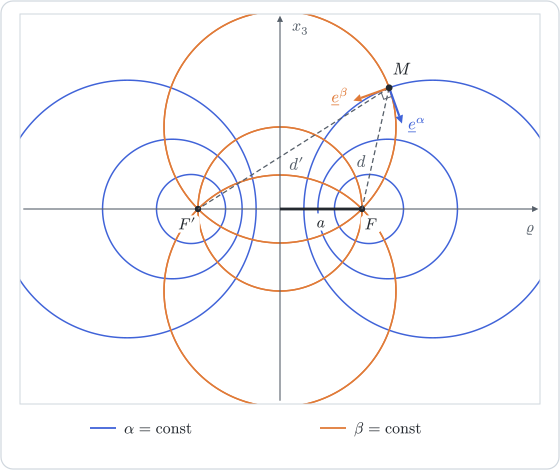

# [Toroidal coordinates](@id th-toroidal)

!!! tip "See also"
    **Theory**: [Toroidal functions](@ref th-toroidal-harmonics) · [Curvilinear differential calculus](@ref th-curvilinear)

    **Manual**: [Coordinate systems (symbolic)](@ref man-coorsystems) · [Charts and coordinate conversions](@ref man-charts) · [Toroidal functions](@ref man-toroidal-harmonics)

A torus is the surface swept by a circle that revolves about an axis of its
plane. The toroidal coordinates are the orthogonal system in which a family of
tori sharing a focal circle is a family of coordinate surfaces: the natural
system for a ring-shaped inclusion or a toroidal pore. This page builds the
system with the steps of
[Curvilinear differential calculus](@ref th-curvilinear), writes its
differential operators, separates the Laplace equation and describes a torus
seen as a surface.

## Bipolar coordinates of a meridian plane

In a plane that contains the axis ``\underline{e}_3``, a point ``M`` is located
by its abscissa ``\varrho`` along a direction orthogonal to the axis and by its
height ``z``. Let ``F`` and ``F'`` be the two points ``\varrho=a`` and
``\varrho=-a`` of the line ``z=0``, with ``a>0``, and ``d`` and ``d'`` the
distances from ``M`` to them. Two numbers locate ``M``:

```math
\alpha=\ln\frac{d'}{d},
\qquad
\beta=\widehat{F'MF}\ \text{with the sign of }z .
```

The first is constant on a circle of Apollonius of the pair ``(F,F')``, which
surrounds ``F`` when ``\alpha>0``; the second is constant on an arc of circle
through ``F`` and ``F'``, by the inscribed-angle theorem. The two families
cross at right angles.

Both are the real and imaginary parts of one complex relation. With
``\zeta=\varrho+\mathrm{i}\,z``, the numbers ``\zeta+a`` and ``\zeta-a`` have
the moduli ``d'`` and ``d`` and arguments whose difference is ``-\beta``, so
that

```math
\ln\frac{\zeta+a}{\zeta-a}=\alpha-\mathrm{i}\,\beta
\qquad\Longleftrightarrow\qquad
\zeta=a\,\coth\frac{\alpha-\mathrm{i}\,\beta}{2} .
```

Since
``\coth\frac{x+\mathrm{i}y}{2}=\dfrac{\sinh x-\mathrm{i}\sin y}{\cosh x-\cos y}``,
the Cartesian coordinates of the meridian plane are

```math
\varrho=\frac{a\,\sinh\alpha}{\cosh\alpha-\cos\beta},
\qquad
z=\frac{a\,\sin\beta}{\cosh\alpha-\cos\beta} .
```

The figure shows a meridian plane: the circles of Apollonius (``\alpha``
constant) around ``F`` and ``F'``, the arcs through them (``\beta`` constant),
the distances ``d`` and ``d'`` and, at a point ``M``, the two orthogonal unit
vectors of the chart.



The half-plane ``\varrho\ge0`` is ``\alpha\ge0``, ``-\pi<\beta\le\pi``. Its
edge, the axis, is ``\alpha=0``, with the origin at ``\beta=\pi`` and the point
at infinity at ``\beta=0``; the point ``F`` is ``\alpha\to\infty``.

## The toroidal system

Revolving the half-plane about the axis gives the **toroidal** system
``(\varphi,\alpha,\beta)``, in which ``F`` describes the **focal circle** of
radius ``a`` of the plane ``x_3=0``:

```math
\underline{OM}=\frac{a}{\delta}\,\bigl(\sinh\alpha\,\underline{u}_\varphi+\sin\beta\,\underline{e}_3\bigr),
\qquad
\underline{u}_\varphi=\cos\varphi\,\underline{e}_1+\sin\varphi\,\underline{e}_2,
\qquad
\delta=\cosh\alpha-\cos\beta .
```

The surface ``\alpha=\text{const}`` is a torus. Eliminating ``\beta`` between
``\varrho`` and ``z`` gives

```math
\bigl(\varrho-a\,\coth\alpha\bigr)^2+z^2=\frac{a^2}{\sinh^2\alpha} ,
```

the circle of center ``\varrho=a\coth\alpha`` and radius ``a/\sinh\alpha``. A
torus of center-line radius ``R`` and tube radius ``r<R`` is therefore the
surface ``\alpha=\alpha_0`` of the system of focal radius ``a`` with

```math
a=\sqrt{R^2-r^2},
\qquad
\cosh\alpha_0=\frac{R}{r} ;
```

its inside is ``\alpha>\alpha_0``. Eliminating ``\alpha`` gives the surface
``\beta=\text{const}``,

```math
\varrho^2+\bigl(z-a\,\cot\beta\bigr)^2=\frac{a^2}{\sin^2\beta} ,
```

the cap, on the side ``z/\beta>0``, of the sphere of center
``a\cot\beta\,\underline{e}_3`` through the focal circle. The surface
``\varphi=\text{const}`` is a half-plane bounded by the axis.

The natural vectors are the derivatives of the position vector. With
``\partial\delta/\partial\alpha=\sinh\alpha`` and
``\partial\delta/\partial\beta=\sin\beta``,

```math
\underline{a}_\varphi=\frac{a\,\sinh\alpha}{\delta}\,\underline{e}^\varphi,
\qquad
\underline{a}_\alpha=\frac{a}{\delta^2}\,\Bigl(\bigl(1-\cosh\alpha\cos\beta\bigr)\,\underline{u}_\varphi-\sinh\alpha\sin\beta\,\underline{e}_3\Bigr),
```

```math
\underline{a}_\beta=\frac{a}{\delta^2}\,\Bigl(-\sinh\alpha\sin\beta\,\underline{u}_\varphi+\bigl(\cosh\alpha\cos\beta-1\bigr)\,\underline{e}_3\Bigr),
```

with ``\underline{e}^\varphi=-\sin\varphi\,\underline{e}_1+\cos\varphi\,\underline{e}_2``.
The last two are orthogonal, their components being ``(A,B)`` and ``(B,-A)``,
and they have the same norm, since

```math
\bigl(1-\cosh\alpha\cos\beta\bigr)^2+\sinh^2\alpha\,\sin^2\beta
=\cosh^2\alpha-2\cosh\alpha\cos\beta+\cos^2\beta=\delta^2 .
```

The Lamé coefficients are thus

```math
\chi_\varphi=\frac{a\,\sinh\alpha}{\delta},
\qquad
\chi_\alpha=\chi_\beta=\frac{a}{\delta},
```

and the normalized basis, ordered as the coordinates, is the right-handed triad

```math
\underline{e}^\varphi,
\qquad
\underline{e}^\alpha=\frac{\bigl(1-\cosh\alpha\cos\beta\bigr)\,\underline{u}_\varphi-\sinh\alpha\sin\beta\,\underline{e}_3}{\delta},
\qquad
\underline{e}^\beta=\frac{-\sinh\alpha\sin\beta\,\underline{u}_\varphi+\bigl(\cosh\alpha\cos\beta-1\bigr)\,\underline{e}_3}{\delta} .
```

The equality ``\chi_\alpha=\chi_\beta`` expresses that the map
``(\alpha,\beta)\mapsto(\varrho,z)`` is conformal, as the complex relation of
the previous section shows. The vector ``\underline{e}^\alpha`` points toward
the focal circle: into the torus ``\alpha=\text{const}``.

Far from the focal circle, ``\alpha`` and ``\beta`` both tend to zero and
``\delta\simeq(\alpha^2+\beta^2)/2``, so that
``\underline{OM}\simeq 2a\,(\alpha\,\underline{u}_\varphi+\beta\,\underline{e}_3)/(\alpha^2+\beta^2)``:
the pair ``(\alpha,\beta)`` is, up to the factor ``2a``, the image of
``(\varrho,z)`` by the inversion of the meridian plane.

[`coorsys_toroidal`](@ref) returns this system; [`ToroidalChart`](@ref) is the
same map between numbers.

The figure draws the system at a point set by the sliders; a fourth slider sets
``a``, the unit vectors of the canonical basis giving the scale.

```@raw html
<ClientOnly><FrameFigure kind="toroidal" /></ClientOnly>
```

## Volume and surface elements

The volume element is the product of the three Lamé coefficients, and the
surface element of a torus ``\alpha=\text{const}`` the product of the two
tangent ones:

```math
\mathrm{d}\Omega=\frac{a^3\,\sinh\alpha}{\delta^3}\,\mathrm{d}\varphi\,\mathrm{d}\alpha\,\mathrm{d}\beta,
\qquad
\mathrm{d}S_\alpha=\frac{a^2\,\sinh\alpha}{\delta^2}\,\mathrm{d}\varphi\,\mathrm{d}\beta .
```

Two integrals over the angle ``\beta`` are needed,

```math
\int_{-\pi}^{\pi}\frac{\mathrm{d}\beta}{\delta^2}=\frac{2\pi\,\cosh\alpha}{\sinh^3\alpha},
\qquad
\int_{-\pi}^{\pi}\frac{\mathrm{d}\beta}{\delta^3}=\frac{\pi\,\bigl(2\cosh^2\alpha+1\bigr)}{\sinh^5\alpha} ,
```

both obtained by differentiating
``\int_{-\pi}^{\pi}\mathrm{d}\beta/\delta=2\pi/\sinh\alpha`` with respect to
``\cosh\alpha``. The area of the torus ``\alpha=\alpha_0`` follows,

```math
S=2\pi\,a^2\,\sinh\alpha_0\,\frac{2\pi\,\cosh\alpha_0}{\sinh^3\alpha_0}
=4\pi^2\,\bigl(a\coth\alpha_0\bigr)\,\frac{a}{\sinh\alpha_0}=4\pi^2\,R\,r ,
```

and its volume, the integral over ``\alpha\ge\alpha_0``, with
``\dfrac{\mathrm{d}}{\mathrm{d}\alpha}\dfrac{\cosh\alpha}{\sinh^3\alpha}=-\dfrac{2\cosh^2\alpha+1}{\sinh^4\alpha}``:

```math
V=2\pi^2\,a^3\int_{\alpha_0}^{\infty}\frac{2\cosh^2\alpha+1}{\sinh^4\alpha}\,\mathrm{d}\alpha
=2\pi^2\,a^3\,\frac{\cosh\alpha_0}{\sinh^3\alpha_0}=2\pi^2\,R\,r^2 .
```

These are the two theorems of Pappus for a circle of radius ``r`` whose center
describes a circle of radius ``R``.

## Differential operators

The gradient of a scalar field divides each derivative by its Lamé
coefficient:

```math
\underline{\mathrm{grad}}\,f=\frac{\delta}{a}\,\Bigl(\frac{1}{\sinh\alpha}\,\frac{\partial f}{\partial\varphi}\,\underline{e}^\varphi
+\frac{\partial f}{\partial\alpha}\,\underline{e}^\alpha+\frac{\partial f}{\partial\beta}\,\underline{e}^\beta\Bigr) .
```

The Laplacian of an orthogonal system is
``\Delta f=\dfrac{1}{\chi_1\chi_2\chi_3}\displaystyle\sum_i\dfrac{\partial}{\partial\xi_i}\Bigl(\dfrac{\chi_1\chi_2\chi_3}{\chi_i^2}\,\dfrac{\partial f}{\partial\xi_i}\Bigr)``
([Curvilinear differential calculus](@ref th-curvilinear)), which gives here

```math
\Delta f=\frac{\delta^3}{a^2\,\sinh\alpha}\,\Bigl[\frac{\partial}{\partial\alpha}\Bigl(\frac{\sinh\alpha}{\delta}\,\frac{\partial f}{\partial\alpha}\Bigr)
+\frac{\partial}{\partial\beta}\Bigl(\frac{\sinh\alpha}{\delta}\,\frac{\partial f}{\partial\beta}\Bigr)\Bigr]
+\frac{\delta^2}{a^2\,\sinh^2\alpha}\,\frac{\partial^2 f}{\partial\varphi^2} .
```

The operators of vector and tensor fields follow from the Christoffel symbols
that [`coorsys_toroidal`](@ref) computes; they are not written here.

## Separation of the Laplace equation

The factor ``1/\delta`` under the derivatives prevents a product
``A(\alpha)\,B(\beta)\,\Phi(\varphi)`` from being harmonic. The equation
separates once a factor ``\sqrt{\delta}`` is taken out. Let
``f=\sqrt{\delta}\;u``. Then

```math
\frac{\sinh\alpha}{\delta}\,\frac{\partial f}{\partial\alpha}
=\frac{\sinh\alpha}{\sqrt{\delta}}\,\frac{\partial u}{\partial\alpha}+\frac{\sinh^2\alpha}{2\,\delta^{3/2}}\,u,
\qquad
\frac{\sinh\alpha}{\delta}\,\frac{\partial f}{\partial\beta}
=\frac{\sinh\alpha}{\sqrt{\delta}}\,\frac{\partial u}{\partial\beta}+\frac{\sinh\alpha\,\sin\beta}{2\,\delta^{3/2}}\,u .
```

In the derivative of each expression, the terms in the first derivative of
``u`` that come from ``\delta`` cancel. There remain

```math
\frac{\partial}{\partial\alpha}\Bigl(\frac{\sinh\alpha}{\delta}\,\frac{\partial f}{\partial\alpha}\Bigr)
=\frac{1}{\sqrt{\delta}}\Bigl(\sinh\alpha\,\frac{\partial^2u}{\partial\alpha^2}+\cosh\alpha\,\frac{\partial u}{\partial\alpha}\Bigr)
+\Bigl(\frac{\sinh\alpha\cosh\alpha}{\delta^{3/2}}-\frac{3\,\sinh^3\alpha}{4\,\delta^{5/2}}\Bigr)\,u ,
```

```math
\frac{\partial}{\partial\beta}\Bigl(\frac{\sinh\alpha}{\delta}\,\frac{\partial f}{\partial\beta}\Bigr)
=\frac{\sinh\alpha}{\sqrt{\delta}}\,\frac{\partial^2u}{\partial\beta^2}
+\Bigl(\frac{\sinh\alpha\cos\beta}{2\,\delta^{3/2}}-\frac{3\,\sinh\alpha\,\sin^2\beta}{4\,\delta^{5/2}}\Bigr)\,u .
```

The terms in ``u`` add up, with
``\sinh^2\alpha+\sin^2\beta=\cosh^2\alpha-\cos^2\beta=\delta\,(\cosh\alpha+\cos\beta)``,
to

```math
\frac{\sinh\alpha}{\delta^{3/2}}\Bigl(\cosh\alpha+\frac{\cos\beta}{2}-\frac{3}{4}\,(\cosh\alpha+\cos\beta)\Bigr)\,u
=\frac{\sinh\alpha}{4\,\sqrt{\delta}}\,u ,
```

and the Laplacian becomes

```math
\Delta\bigl(\sqrt{\delta}\;u\bigr)=\frac{\delta^{5/2}}{a^2}\,\Bigl[\frac{\partial^2u}{\partial\alpha^2}+\coth\alpha\,\frac{\partial u}{\partial\alpha}
+\frac{\partial^2u}{\partial\beta^2}+\frac{u}{4}+\frac{1}{\sinh^2\alpha}\,\frac{\partial^2u}{\partial\varphi^2}\Bigr] .
```

The bracket no longer contains ``\delta``: a product
``u=A(\alpha)\,\mathrm{e}^{\mathrm{i}n\beta}\,\mathrm{e}^{\mathrm{i}m\varphi}``,
with ``n`` and ``m`` integers for a field that is single-valued, makes it
vanish when

```math
A''+\coth\alpha\,A'+\Bigl(\frac{1}{4}-n^2-\frac{m^2}{\sinh^2\alpha}\Bigr)\,A=0 .
```

With the variable ``t=\cosh\alpha\ge1``, for which
``A'=\sinh\alpha\,\mathrm{d}A/\mathrm{d}t`` and
``A''=\sinh^2\alpha\,\mathrm{d}^2A/\mathrm{d}t^2+t\,\mathrm{d}A/\mathrm{d}t``,
this is Legendre's equation

```math
(1-t^2)\,\frac{\mathrm{d}^2A}{\mathrm{d}t^2}-2\,t\,\frac{\mathrm{d}A}{\mathrm{d}t}
+\Bigl(\nu\,(\nu+1)-\frac{m^2}{1-t^2}\Bigr)\,A=0,
\qquad
\nu=n-\frac{1}{2} ,
```

since ``\nu(\nu+1)=n^2-\tfrac14``. Its degree is a half-integer. The harmonic
functions that separate in toroidal coordinates are therefore

```math
\sqrt{\cosh\alpha-\cos\beta}\;
\Bigl\{P^m_{n-1/2}(\cosh\alpha),\;Q^m_{n-1/2}(\cosh\alpha)\Bigr\}\;
\mathrm{e}^{\mathrm{i}n\beta}\,\mathrm{e}^{\mathrm{i}m\varphi} ,
```

where ``P^m_\nu`` and ``Q^m_\nu`` are the Legendre functions of the first and
second kinds of argument larger than one. ``P^m_{n-1/2}(\cosh\alpha)`` is
bounded on the axis ``\alpha=0`` and grows toward the focal circle;
``Q^m_{n-1/2}(\cosh\alpha)`` is bounded at the focal circle and singular on the
axis. A field regular outside a torus is thus a series of the first, and a
field regular inside it a series of the second.

## The torus as a surface

On the torus ``\alpha=\alpha_0`` of radii ``R`` and ``r``, the point of
azimuth ``\varphi`` and poloidal angle ``\theta``, measured in the meridian
plane from the outer equator, is

```math
\underline{OM}=(R+r\cos\theta)\,\underline{u}_\varphi+r\sin\theta\,\underline{e}_3 .
```

Comparing with the position vector of the system gives the relation between
the poloidal angle and the coordinate ``\beta``,

```math
\cos\theta=\frac{\cosh\alpha_0\cos\beta-1}{\cosh\alpha_0-\cos\beta},
\qquad
\sin\theta=\frac{\sinh\alpha_0\,\sin\beta}{\cosh\alpha_0-\cos\beta} ,
```

so that ``\underline{e}^\alpha=-(\cos\theta\,\underline{u}_\varphi+\sin\theta\,\underline{e}_3)``:
the outward unit normal of the torus is
``\underline{n}=-\underline{e}^\alpha``. The outer equator ``\theta=0`` is
``\beta=0`` and the inner one ``\theta=\pi`` is ``\beta=\pi``. The angle
``\beta`` is not the poloidal angle: equal steps of ``\beta`` are closer
together, on the torus, on the side of the axis. The surface element is
``\mathrm{d}S=r\,(R+r\cos\theta)\,\mathrm{d}\varphi\,\mathrm{d}\theta``, equal to
``\mathrm{d}S_{\alpha_0}`` above.
